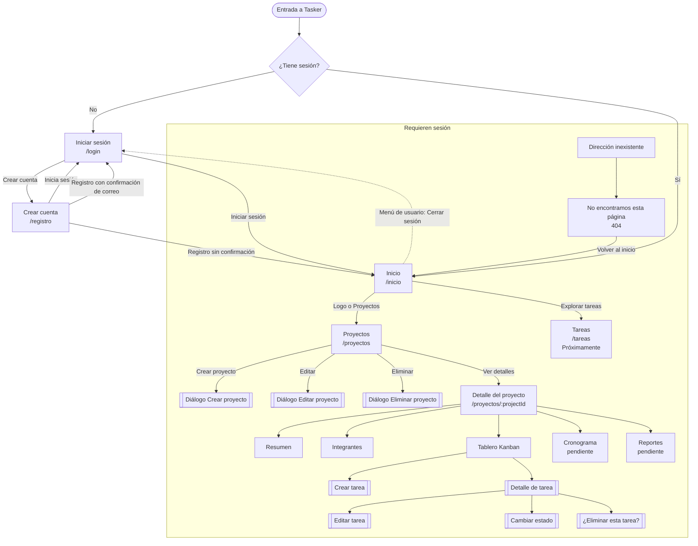

# Estructura de navegación de Tasker

Documento base para redactar el manual de usuario. Describe las pantallas, cómo se llega a cada una, para qué sirven y qué puede hacer la persona usuaria en ellas. No es documentación técnica.

Los textos entre comillas son los que muestra la interfaz. El manual debe usar las mismas palabras. Lo que aún no funciona está marcado como pendiente.

Fuente: código de `frontend/src/app` en la rama `develop`, revisado para la HU-48 (SCRUM-66).

## 1. Qué es Tasker y para quién es

Tasker es una aplicación web para organizar proyectos y tareas académicas. Está pensada para estudiantes universitarios que trabajan en equipo: crean proyectos, siguen el avance de las tareas en un tablero Kanban y consultan quién es responsable de cada una. Se desarrolló en la asignatura Administración de Proyectos Informáticos (API115) de la Universidad de El Salvador.

## 2. Mapa de navegación

### 2.1. Árbol de rutas

```text
/login                         Iniciar sesión          (solo sin sesión)
/registro                      Crear cuenta            (solo sin sesión)

(requieren sesión)
/                              redirige a /inicio
/inicio                        Inicio
/proyectos                     Proyectos
  Diálogos: Crear proyecto, Editar proyecto, Eliminar proyecto
/proyectos/:projectId          Detalle del proyecto
  Sección Resumen              (por defecto)
  Sección Integrantes          (?seccion=integrantes)
  Sección Tablero Kanban       (?seccion=kanban)
    Diálogos: Crear tarea, Detalle de tarea, Editar tarea,
              Cambiar estado, ¿Eliminar esta tarea?
  Cronograma                   (deshabilitada, pendiente)
  Reportes                     (deshabilitada, pendiente)
/tareas                        Tareas                  (pendiente, "Próximamente")
cualquier otra dirección       No encontramos esta página (404)
```

Reglas de acceso:

- Las rutas privadas piden sesión. Sin sesión, la aplicación lleva a `/login`.
- `/login` y `/registro` son solo para quien no ha iniciado sesión. Con sesión activa, la aplicación lleva a `/inicio`.
- La página de error 404 se muestra dentro del diseño general, por lo que también exige sesión. Sin sesión, quien escriba una dirección inexistente llega al inicio de sesión.

### 2.2. Diagrama



## 3. Elementos comunes

Todas las pantallas privadas comparten la barra superior y el contenido principal. Las pantallas de inicio de sesión y de registro no la muestran.

### Enlace "Saltar al contenido"

Es el primer elemento de la página. Solo se aprecia al navegar con el teclado (tecla Tab). Al activarlo, el foco pasa al contenido principal y evita recorrer la barra superior.

### Barra superior

- Logo de Tasker, a la izquierda. Lleva a Proyectos.
- Enlace "Proyectos". Queda resaltado mientras la persona está en Proyectos o en el detalle de un proyecto.
- Menú de usuario, a la derecha. Muestra el nombre completo de la persona. Si la cuenta no tiene nombre guardado, muestra "Mi cuenta".

### Menú de usuario

Al abrirlo se ve:

- "Sesión iniciada como" y el nombre completo.
- Botón "Cerrar sesión".

Al pulsar "Cerrar sesión" el botón cambia a "Cerrando sesión…" y, al terminar, la aplicación lleva a Iniciar sesión. Si falla, aparece el mensaje "No pudimos completar el cierre de sesión. Inténtalo nuevamente." y la persona sigue dentro de la aplicación.

> 📷 Captura: barra superior con el menú de usuario abierto.

## 4. Fichas por pantalla

### 4.1. Iniciar sesión

- Ruta: `/login`. Título de la pestaña: "Iniciar sesión | Tasker".
- Para qué sirve: entrar a la cuenta para acceder al espacio de trabajo.
- Cómo se llega: es la pantalla a la que se redirige a quien no tiene sesión; también desde el enlace "Inicia sesión" de Crear cuenta y al cerrar sesión.
- Qué contiene:
  - Título "Inicia sesión" y el texto "Accede a tu espacio de trabajo."
  - Campo "Correo electrónico" (ejemplo: nombre@ejemplo.com).
  - Campo "Contraseña" (texto de ayuda: "Introduce tu contraseña").
  - Botón "Iniciar sesión".
  - Texto "¿No tienes una cuenta?" con el enlace "Crear cuenta".
  - Aviso opcional, visible tras registrarse con confirmación de correo (ver sección 5.1).
- Acciones disponibles:
  1. Escribir el correo electrónico.
  2. Escribir la contraseña.
  3. Pulsar "Iniciar sesión". El botón cambia a "Iniciando sesión…".
  4. Si los datos son correctos, la aplicación abre Inicio.
- Validaciones y mensajes:
  - Correo vacío: "Ingresa tu correo electrónico."
  - Correo con formato incorrecto: "Ingresa un correo electrónico válido."
  - Contraseña vacía: "Ingresa tu contraseña."
  - Datos que no coinciden: "Correo o contraseña incorrectos. Revisa los datos e inténtalo de nuevo."
  - Falla del servicio: "No pudimos iniciar sesión. Inténtalo de nuevo en unos minutos."
  - Aviso tras el registro: "Solicitud recibida. Si el registro corresponde a una cuenta nueva, recibirás un correo para confirmarla antes de iniciar sesión. Revisa también la carpeta de spam. Si ya tienes una cuenta, puedes iniciar sesión."
- Estado: implementada.

> 📷 Captura: pantalla vacía, con errores de validación y con el aviso de correo de confirmación.

### 4.2. Crear cuenta

- Ruta: `/registro`. Título de la pestaña: "Crear cuenta | Tasker".
- Para qué sirve: registrar una cuenta nueva.
- Cómo se llega: desde el enlace "Crear cuenta" de Iniciar sesión.
- Qué contiene:
  - Título "Crea tu cuenta" y el texto "Regístrate para comenzar a utilizar Tasker."
  - Campos: "Nombre completo" ("Escribe tu nombre completo"), "Correo electrónico", "Contraseña" ("Crea una contraseña") y "Confirmar contraseña" ("Repite tu contraseña").
  - Botón "Crear cuenta".
  - Texto "¿Ya tienes una cuenta?" con el enlace "Inicia sesión".
- Acciones disponibles:
  1. Completar los cuatro campos.
  2. Pulsar "Crear cuenta". El botón cambia a "Creando cuenta…" y los campos se bloquean mientras se procesa.
  3. Si la cuenta requiere confirmar el correo, la aplicación abre Iniciar sesión con el aviso de solicitud recibida. Si no la requiere, abre Inicio con la sesión iniciada.
- Validaciones y mensajes:
  - Nombre vacío o solo espacios: "Ingresa tu nombre completo."
  - Correo vacío: "Ingresa tu correo electrónico." Formato incorrecto: "Ingresa un correo electrónico válido."
  - Contraseña vacía: "Ingresa una contraseña."
  - Confirmación vacía: "Confirma tu contraseña." Si no coincide: "Las contraseñas no coinciden."
  - Error general: "No pudimos completar la operación. Si ya creaste tu cuenta, intenta iniciar sesión."
  - Si el servicio de cuentas rechaza el registro, se muestra el mensaje que devuelve.
- Estado: implementada. La política de contraseñas (longitud y complejidad) no figura en la pantalla; el manual no debe afirmar requisitos que la interfaz no muestra.

> 📷 Captura: formulario completo y error "Las contraseñas no coinciden."

### 4.3. Inicio

- Ruta: `/inicio`. Título de la pestaña: "Inicio | Tasker". También se llega con `/`.
- Para qué sirve: pantalla de bienvenida tras iniciar sesión.
- Cómo se llega: al iniciar sesión, al crear una cuenta sin confirmación de correo y desde "Volver al inicio" de la página 404.
- Qué contiene:
  - Encabezado "Tu espacio, en orden" y "Cada gran idea empieza con un paso."
  - Texto "Bienvenido a Tasker. Un espacio para organizar tus tareas y avanzar en tus proyectos."
  - Tarjeta "Comienza aquí" con el título "Haz espacio para lo importante" y un botón "Explorar tareas".
  - Dos tarjetas con la etiqueta "Próximamente": "Organiza tus proyectos" y "Avanza con tu equipo".
- Acciones disponibles:
  1. Pulsar "Explorar tareas" para abrir la página Tareas (hoy sin funciones, ver sección 6).
  2. Usar el enlace "Proyectos" de la barra superior para trabajar con proyectos.
- Validaciones y mensajes: no tiene.
- Estado: parcial. Es informativa. Los textos de las tarjetas hablan de funciones como "próximamente" aunque los proyectos ya están disponibles en la pantalla Proyectos. El manual debe dirigir a Proyectos como punto de partida real.

> 📷 Captura: pantalla de inicio completa.

### 4.4. Proyectos

- Ruta: `/proyectos`. Título de la pestaña: "Proyectos | Tasker".
- Para qué sirve: ver los proyectos a los que la persona tiene acceso y administrarlos.
- Cómo se llega: logo o enlace "Proyectos" de la barra superior; enlace "Volver a proyectos" y migas de pan del detalle.
- Qué contiene:
  - Encabezado "Proyectos" con el texto "Consulta y administra los proyectos a los que tienes acceso." y el botón "Crear proyecto".
  - Una tarjeta por proyecto con: etiqueta "Propietario" o "Integrante", nombre, descripción (si existe), "Inicio", "Finalización" y barra "Avance del proyecto" con su porcentaje.
  - Botón "Ver detalles" en cada tarjeta. Los botones "Editar" y "Eliminar" aparecen solo en los proyectos de los que la persona es propietaria.
- Estados de la pantalla:
  - Cargando: "Cargando proyectos…"
  - Sin proyectos: "Todavía no hay proyectos" y "Aquí aparecerán los proyectos a los que tengas acceso." con el botón "Crear proyecto".
  - Error: "No se pudieron cargar los proyectos" y "Vuelve a intentarlo. Tus datos no se han modificado." con el botón "Reintentar".
- Acciones disponibles: crear, editar, eliminar y abrir un proyecto (ver los diálogos siguientes y la ficha 4.5).
- Estado: implementada.

> 📷 Captura: listado con proyectos propios y compartidos, y estado vacío.

#### Diálogo "Crear proyecto"

- Cómo se abre: botón "Crear proyecto" (del encabezado o del estado vacío).
- Contenido: título "Crear proyecto" y descripción "Define la información del proyecto." Campos: "Nombre (obligatorio)" ("Nombre del proyecto"), "Descripción" ("Descripción del proyecto"), "Fecha de inicio" y "Fecha de finalización". Botones "Cancelar" y "Crear proyecto".
- Pasos:
  1. Pulsar "Crear proyecto".
  2. Escribir el nombre. Las fechas y la descripción son opcionales.
  3. Pulsar "Crear proyecto". El botón cambia a "Guardando…".
  4. El diálogo se cierra y el proyecto nuevo aparece en el listado, resaltado. Se anuncia "Proyecto «nombre» creado."
- Mensajes:
  - Nombre vacío: "Ingresa el nombre del proyecto."
  - Fecha de finalización anterior al inicio: "No puede ser anterior a la fecha de inicio."
  - Sesión vencida: "Tu sesión expiró. Inicia sesión de nuevo; se conservan los valores mostrados."
  - Otro error: "No se pudo guardar el proyecto. Se conservan los valores mostrados."
- Si se cierra con "Cancelar" sin guardar, lo escrito se conserva hasta crear el proyecto.

> 📷 Captura: diálogo con el error de nombre y con el error de fechas.

#### Diálogo "Editar proyecto"

- Cómo se abre: botón "Editar" de una tarjeta (solo propietario).
- Contenido: título "Editar proyecto" y descripción "Actualiza la información del proyecto." Mismos campos que al crear, con los valores guardados. Botones "Cancelar" y "Guardar cambios".
- Pasos:
  1. Pulsar "Editar" en el proyecto.
  2. Cambiar los datos que hagan falta.
  3. Pulsar "Guardar cambios" ("Guardando…" mientras se procesa).
  4. El diálogo se cierra y la tarjeta se actualiza. Se anuncia "Proyecto «nombre» actualizado."
- Notas: si no hubo cambios, "Guardar cambios" solo cierra el diálogo. Con cambios sin guardar, hacer clic fuera del diálogo no lo cierra; hay que usar "Cancelar" o la X.
- Mensajes: los mismos de crear, más "No se pudo guardar: el proyecto ya no existe o no tienes permiso para editarlo."

> 📷 Captura: diálogo de edición con datos cargados.

#### Diálogo "Eliminar proyecto"

- Cómo se abre: botón "Eliminar" de una tarjeta (solo propietario).
- Contenido: título "Eliminar proyecto", el nombre del proyecto y el texto "La eliminación también alcanza a sus integrantes y a las asignaciones de sus tareas. Esta acción no se puede deshacer." Botones "Cancelar" y "Eliminar proyecto".
- Pasos:
  1. Pulsar "Eliminar" en el proyecto.
  2. Leer la advertencia.
  3. Pulsar "Eliminar proyecto" ("Eliminando…") o "Cancelar".
  4. Al terminar, el proyecto desaparece del listado. Se anuncia "Proyecto «nombre» eliminado."
- Mensajes:
  - "Tu sesión expiró. Inicia sesión de nuevo e inténtalo otra vez."
  - "No se pudo eliminar: el proyecto ya no existe o no tienes permiso."
  - "No se pudo eliminar: el proyecto tiene tareas asociadas."
  - "No se pudo eliminar el proyecto. Inténtalo de nuevo."

> 📷 Captura: diálogo de confirmación de eliminación.

### 4.5. Detalle del proyecto

- Ruta: `/proyectos/:projectId`. Título de la pestaña: "Detalle del proyecto | Tasker".
- Para qué sirve: ver un proyecto completo y trabajar con sus tareas.
- Cómo se llega: botón "Ver detalles" de una tarjeta de Proyectos.
- Qué contiene:
  - Migas de pan "Proyectos / Detalle". El enlace "Proyectos" regresa al listado.
  - Nombre y descripción del proyecto ("Sin descripción." si no hay).
  - Botón "Editar" (solo propietario, en las secciones Resumen e Integrantes). Abre el mismo diálogo "Editar proyecto" de la ficha 4.4.
  - Menú de secciones "Secciones del proyecto": "Resumen", "Integrantes", "Tablero Kanban", "Cronograma" y "Reportes". Las dos últimas están deshabilitadas y muestran "Todavía no disponible".
  - Botón "Crear tarea" (solo propietario, solo en la sección Tablero Kanban).
- Estados de la pantalla:
  - Cargando: "Cargando información del proyecto…"
  - Error: "No se pudo cargar el proyecto" con el motivo y el botón "Reintentar". Motivos: "No pudimos cargar la información del proyecto."
  - No disponible: "Proyecto no disponible" y "El proyecto no existe o no tienes permiso para consultarlo." con el botón "Volver a proyectos".
- Acciones disponibles: cambiar de sección con el menú; cada sección se explica abajo. La sección elegida se conserva al recargar la página.
- Estado: implementada, con Cronograma y Reportes pendientes.

> 📷 Captura: encabezado del proyecto con el menú de secciones.

#### Sección "Resumen"

- Se abre por defecto. Contiene tres paneles y la lista de integrantes:
  - "Información del proyecto": "Propietario", "Tu rol" ("Propietario" o "Integrante"), "Inicio", "Finalización" y la barra "Avance del proyecto" con el porcentaje y el texto "X de Y tareas completadas".
  - Si hay tareas canceladas: "Las tareas canceladas no se incluyen en el cálculo."
  - "Resumen de tareas por estado": "Por hacer", "En progreso", "En revisión", "Completadas", "Canceladas" y "Vencidas", más "Total de tareas: N".
  - "Tareas del proyecto": cada tarea con su nombre, estado, número (#N) y "Fecha límite". Sin tareas: "Todavía no hay tareas asociadas al proyecto."
- Acciones: solo consulta.

> 📷 Captura: sección Resumen con tareas.

#### Sección "Integrantes"

- Contiene el título "Integrantes", el conteo ("N integrantes · incluye al propietario") y la lista con avatar, nombre, correo ("Correo no disponible" si falta) y la etiqueta de rol.
- Texto fijo: "El propietario no puede ser removido."
- Botones "Agregar" y "Quitar" (solo el propietario los ve): están deshabilitados y muestran "Todavía no disponible". El texto "La administración de integrantes todavía no está disponible." lo confirma.
- Estado: parcial. Solo se puede consultar la lista. Agregar y quitar integrantes está pendiente.

> 📷 Captura: lista de integrantes vista por el propietario.

#### Sección "Tablero Kanban"

- Qué contiene:
  - Buscador "Buscar tareas…". Mientras hay texto aparece el botón "Limpiar" y un conteo ("1 tarea encontrada", "N tareas encontradas" o "No se encontraron tareas. Prueba con otro título o limpia la búsqueda.").
  - Cinco columnas con su número de tareas: "Por hacer", "En progreso", "En revisión", "Completada" y "Cancelada".
  - Cada tarjeta muestra nombre, estado, fecha de entrega, responsables ("Sin responsable" si no hay), la marca "Vencida" cuando corresponde y el botón "Cambiar estado" si la persona puede moverla.
  - Avisos sobre el tablero: "Estado actualizado", "Tarea actualizada", "Tarea eliminada" y "Guardando cambio de estado…".
- Estados: "Cargando tareas…", "Todavía no hay tareas" con "Las tareas de este proyecto aparecerán aquí." y error "No se pudieron cargar las tareas" con "Intenta nuevamente para consultar el tablero." y el botón "Reintentar".
- Quién puede qué:
  - Propietario: crear, ver, editar y eliminar tareas, y mover cualquier tarea a cualquier columna.
  - Integrante responsable de una tarea: ver la tarea y moverla entre "Por hacer", "En progreso" y "Completada".
  - Integrante no responsable: solo consulta; no ve "Cambiar estado" ni puede arrastrar la tarjeta.
- Acciones disponibles:
  1. Pulsar el nombre de una tarea para abrir su detalle.
  2. Arrastrar la tarjeta a otra columna, o usar "Cambiar estado".
  3. Buscar por título con "Buscar tareas…".
- Mensajes al cambiar de estado: "Estado actualizado" con "«Tarea» ahora está en Estado." Si falla: "No se pudo cambiar el estado" con "La tarea volvió a Estado. El cambio no se guardó."
- Estado: implementada. La asignación de responsables desde la interfaz está pendiente (ver Crear tarea).

> 📷 Captura: tablero con las cinco columnas, y búsqueda con resultados.

#### Diálogo "Crear tarea"

- Cómo se abre: botón "Crear tarea" (solo propietario, sección Tablero Kanban).
- Contenido: título "Crear tarea" y el nombre del proyecto. Campos: "Nombre *" ("Nombre de la tarea"), "Descripción" ("Describe la tarea"), "Fecha de inicio" y "Fecha de entrega". El campo "Responsables" tiene el botón deshabilitado "Seleccionar integrantes" y el texto "La asignación de responsables todavía no está disponible." La etiqueta "Estado · Por hacer" indica el estado inicial. Pie: "* Campo obligatorio." Botones "Cancelar" y "Crear tarea".
- Pasos:
  1. Pulsar "Crear tarea".
  2. Escribir el nombre y, si se desea, descripción y fechas.
  3. Pulsar "Crear tarea" ("Guardando…").
  4. La tarea aparece en la columna "Por hacer". Se anuncia "Tarea «nombre» creada."
- Mensajes:
  - Nombre vacío: "Ingresa un nombre para la tarea."
  - Fecha inválida: "Ingresa una fecha válida."
  - Entrega anterior al inicio: "La entrega no puede ser anterior al inicio."
  - Sin permiso: "Solo el propietario puede crear tareas en este proyecto."
  - Falla: "No pudimos confirmar la operación. Revisa las tareas antes de reintentar."
- Estado: parcial (sin asignación de responsables).

> 📷 Captura: diálogo Crear tarea con el texto de responsables no disponible.

#### Diálogo "Detalle de tarea"

- Cómo se abre: pulsando el nombre de una tarea en el tablero.
- Contenido: título "Detalle de tarea", nombre, estado, "Complejidad: Baja/Media/Alta" (si existe), "Vencida" (si aplica), descripción ("Sin descripción." si no hay), "Inicio ·", "Entrega ·" y la lista "Responsables" ("Sin responsable" si no hay).
- Botones según el rol: "Cambiar estado" (propietario o responsable), "Editar tarea" y "Eliminar tarea" (propietario) y "Cerrar".
- Acciones: leer la información y abrir los diálogos de cambiar estado, editar o eliminar.

> 📷 Captura: detalle de una tarea con responsable y de una sin responsable.

#### Diálogo "Cambiar estado"

- Cómo se abre: botón "Cambiar estado" en la tarjeta o en el detalle.
- Contenido: título "Cambiar estado", nombre de la tarea, quién cambia el estado ("Propietario del proyecto" o "Nombre · responsable asignado") y la lista "Estados disponibles". El estado actual aparece marcado y deshabilitado. Botón "Cancelar".
- Estados: el propietario ve los cinco; el responsable ve "Por hacer", "En progreso" y "Completada".
- Pasos: elegir el nuevo estado; la tarea cambia de columna al guardar.

> 📷 Captura: menú de estados para propietario y para responsable.

#### Diálogo "Editar tarea"

- Cómo se abre: botón "Editar tarea" del detalle (solo propietario).
- Contenido: título "Editar tarea" y el nombre del proyecto. Campos "Nombre *", "Descripción", "Fecha de inicio", "Fecha de entrega", los responsables actuales (no editables todavía: "La asignación de responsables todavía no está disponible.") y la etiqueta "Estado · …". Botones "Cancelar" y "Guardar cambios" ("Guardando…").
- Mensajes:
  - Cabecera "Revisa los datos de la tarea" con "Corrige los campos marcados para guardar los cambios."
  - Cabecera "No se pudo guardar la tarea" con uno de estos textos: "La tarea ya no existe o no tienes permiso para editarla. Los datos se conservaron.", "Los datos no cumplen las reglas de la tarea. Revisa las fechas." o "Los datos se conservaron. Puedes volver a intentarlo."
  - Los mismos mensajes de campo que Crear tarea.
- Al guardar, el tablero muestra "Tarea actualizada" con "Se guardaron los cambios de «nombre»."

> 📷 Captura: diálogo Editar tarea con datos cargados.

#### Diálogo "¿Eliminar esta tarea?"

- Cómo se abre: botón "Eliminar tarea" del detalle (solo propietario).
- Contenido: título "¿Eliminar esta tarea?", nombre de la tarea y el texto "La tarea dejará de aparecer en el tablero y el avance del proyecto se actualizará." Botones "Cancelar" y "Eliminar tarea" ("Eliminando…").
- Mensajes:
  - "No se pudo eliminar: la tarea ya no existe o no tienes permiso."
  - "No se pudo eliminar: otras tareas dependen de esta."
  - "No se pudo eliminar la tarea. Inténtalo de nuevo."
- Al terminar, el tablero muestra "Tarea eliminada" con "«nombre» ya no aparece en el tablero."

> 📷 Captura: confirmación de eliminación de tarea.

### 4.6. Tareas

- Ruta: `/tareas`. Título de la pestaña: "Tareas | Tasker".
- Para qué sirve: pensada como lista general de pendientes de la persona.
- Cómo se llega: botón "Explorar tareas" de Inicio.
- Qué contiene: encabezado "Tus tareas", el texto "Aquí podrás consultar y organizar tus pendientes.", el mensaje "Tu espacio está listo", "La creación y gestión de tareas estarán disponibles en una próxima entrega." y la etiqueta "Próximamente".
- Acciones disponibles: ninguna.
- Estado: pendiente. Las tareas se gestionan hoy desde el Tablero Kanban de cada proyecto.

> 📷 Captura: pantalla "Tu espacio está listo".

### 4.7. Página no encontrada

- Ruta: cualquier dirección que no exista. Título de la pestaña: "Página no encontrada | Tasker".
- Para qué sirve: avisar que la dirección no existe.
- Cómo se llega: escribiendo una dirección incorrecta con la sesión iniciada.
- Qué contiene: "Error 404", "No encontramos esta página", "Revisa la dirección o vuelve a tu espacio de trabajo." y el botón "Volver al inicio".
- Acciones: pulsar "Volver al inicio".
- Estado: implementada.

> 📷 Captura: página 404.

## 5. Flujos principales

### 5.1. Crear cuenta e iniciar sesión

1. Abrir Tasker. Sin sesión se muestra "Inicia sesión".
2. Pulsar "Crear cuenta".
3. Completar "Nombre completo", "Correo electrónico", "Contraseña" y "Confirmar contraseña".
4. Pulsar "Crear cuenta".
5. Si aparece "Solicitud recibida. Si el registro corresponde a una cuenta nueva, recibirás un correo para confirmarla antes de iniciar sesión.", abrir el correo y confirmar la cuenta. Revisar también la carpeta de spam.
6. En "Inicia sesión", escribir correo y contraseña y pulsar "Iniciar sesión".
7. Se abre Inicio.

### 5.2. Crear un proyecto

1. Ir a Proyectos con el enlace de la barra superior.
2. Pulsar "Crear proyecto".
3. Escribir el nombre (obligatorio) y, si se desea, descripción y fechas.
4. Pulsar "Crear proyecto".
5. El proyecto aparece en el listado con la etiqueta "Propietario".

### 5.3. Editar un proyecto

1. En Proyectos, pulsar "Editar" en el proyecto. También se puede abrir desde el detalle con el botón "Editar".
2. Cambiar los datos.
3. Pulsar "Guardar cambios".

### 5.4. Eliminar un proyecto

1. En Proyectos, pulsar "Eliminar" en el proyecto.
2. Leer la advertencia: la acción no se puede deshacer.
3. Pulsar "Eliminar proyecto".

### 5.5. Agregar integrantes

Pendiente. La sección "Integrantes" muestra el botón "Agregar" deshabilitado con el aviso "Todavía no disponible". El manual debe indicar que la persona puede consultar la lista, pero aún no puede agregar ni quitar integrantes desde la interfaz.

### 5.6. Crear una tarea

1. Entrar al proyecto con "Ver detalles".
2. Abrir "Tablero Kanban".
3. Pulsar "Crear tarea" (solo propietario).
4. Escribir el nombre y, si se desea, descripción y fechas.
5. Pulsar "Crear tarea".
6. La tarea aparece en la columna "Por hacer", sin responsable.

### 5.7. Mover una tarea en el Kanban

Con el botón:

1. En la tarjeta, pulsar "Cambiar estado".
2. Elegir el nuevo estado en "Estados disponibles".

Con arrastre:

1. Arrastrar la tarjeta a otra columna.
2. Soltarla.

Al terminar, el tablero muestra "Estado actualizado". Si falla, la tarea vuelve a su columna. El propietario mueve cualquier tarea. Un integrante solo mueve las tareas de las que es responsable, y solo entre "Por hacer", "En progreso" y "Completada".

### 5.8. Ver el detalle de una tarea

1. En el Tablero Kanban, pulsar el nombre de la tarea.
2. Revisar estado, complejidad, descripción, fechas y responsables.
3. Pulsar "Cerrar".

### 5.9. Eliminar una tarea

1. Abrir el detalle de la tarea (solo propietario).
2. Pulsar "Eliminar tarea".
3. En "¿Eliminar esta tarea?", pulsar "Eliminar tarea".
4. La tarea sale del tablero y el avance del proyecto se actualiza.

### 5.10. Cerrar sesión

1. Abrir el menú de usuario en la barra superior.
2. Pulsar "Cerrar sesión".
3. Se abre "Inicia sesión".

## 6. Funciones pendientes

Estas funciones están en desarrollo. El manual solo debe mencionarlas como tales.

- Página Tareas (`/tareas`): hoy muestra "Próximamente".
- Cronograma: botón deshabilitado en el detalle del proyecto.
- Reportes: botón deshabilitado en el detalle del proyecto.
- Agregar y quitar integrantes: botones deshabilitados en la sección Integrantes.
- Asignar responsables a una tarea: botón "Seleccionar integrantes" deshabilitado al crear y editar tareas.
- Cálculo de avance: el porcentaje de avance ya aparece en Proyectos y en el Resumen. El README lo lista como función prevista junto con los reportes; confirmar con el equipo de desarrollo su alcance final antes de describirlo en profundidad.

## 7. Notas para el manual

### Usuarios de prueba

Las cuentas de prueba y su procedimiento de carga están en `docs/test-users.md`. No se copian contraseñas aquí. Cuentas útiles para las capturas:

- `propietario@test.com` (Ana Propietaria): propietaria de Proyecto Alpha y Proyecto Beta. Sirve para las capturas de crear, editar y eliminar, y para el Kanban completo.
- `integrante@test.com` (Luis Integrante): integrante de Alpha y responsable de la tarea "Desarrollar login". Sirve para mostrar lo que ve quien no es propietario.
- `sinproyecto@test.com` (Carlos Solitario): sin proyectos. Sirve para el estado vacío de Proyectos.

Las contraseñas están en `docs/test-users.md`. Los datos de prueba solo deben usarse en entornos de desarrollo.

### Recomendaciones para las capturas

- Usar la misma cuenta y el mismo ancho de ventana en todas las capturas de una misma pantalla.
- Tomar cada diálogo abierto, sin cortar el título ni los botones.
- Para los mensajes de error, provocar el error a propósito (campo vacío, fechas invertidas, contraseñas distintas) y capturar el texto completo.
- Capturar las dos vistas por rol (propietario e integrante) en Proyectos, Integrantes y Tablero Kanban, porque los botones cambian.
- Capturar los estados vacío y de carga cuando sea posible.
- No mostrar correos ni datos reales de personas. Usar solo cuentas de prueba.
- Marcar con claridad las capturas de funciones pendientes, para que el manual las identifique como "en desarrollo".
