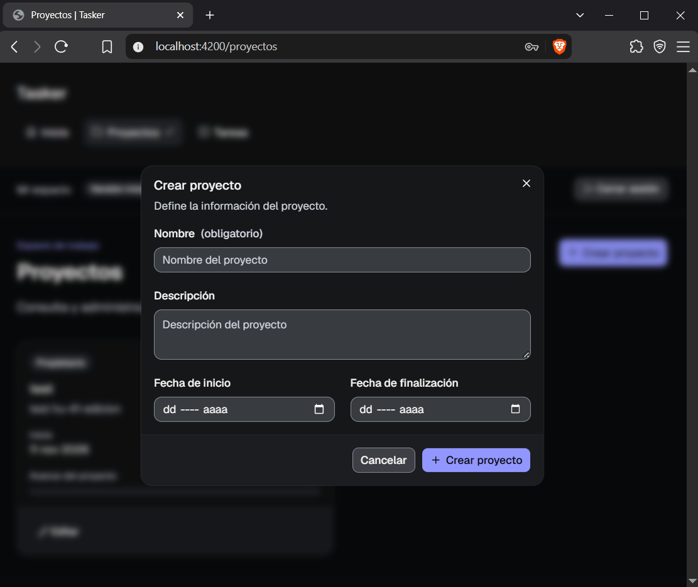
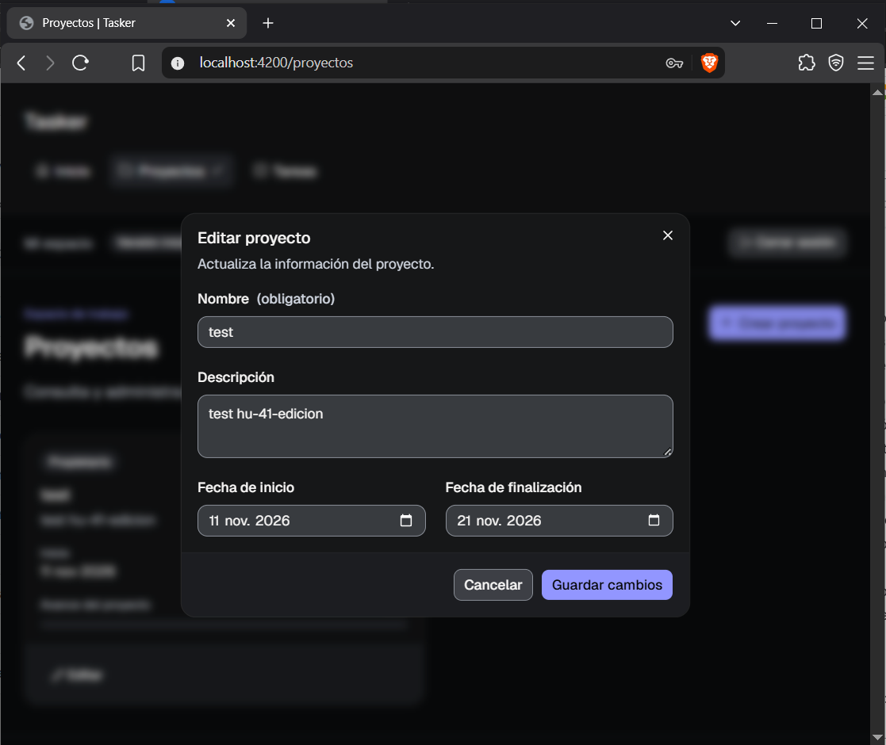
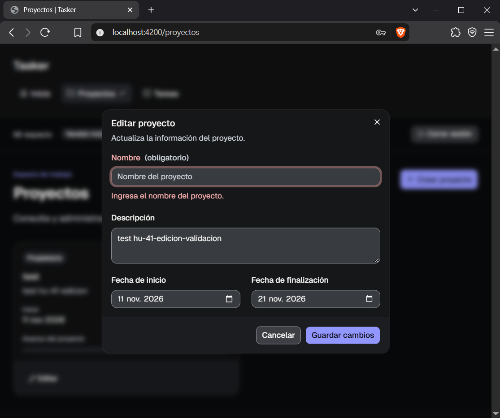

# HU-41 — Registro de ejecución de pruebas de gestión de proyectos

**Proyecto:** Tasker  
**Historia de Jira:** SCRUM-57 — HU-41  
**Enlace:** https://api-proyecto-disc01.atlassian.net/browse/SCRUM-57  
**Responsable:** QA  
**Tipo de ejecución:** Pruebas funcionales manuales  
**Versión del registro:** 1.3  
**Fecha de actualización:** 16 de noviembre de 2026  
**Fecha y hora de las ejecuciones:** Pendientes de completar con los registros originales  
**Ejecutor:** Responsable de QA  
**Rama y commit del frontend probado:** Pendientes de registrar  
**Aplicación:** Angular, `http://localhost:4200`  
**Backend:** Supabase alojado, compartido por el equipo  
**Sistema operativo:** Windows  
**Navegador y versión:** Pendientes de registrar  
**Plan de referencia:** HU-39 — Plan Maestro de Pruebas  
**Datos de referencia:** HU-53 — DS-00, DS-01, DS-02, DS-03, DS-04 y DS-05  
**Estado:** Ejecución funcional actualizada, con un caso bloqueado

## 1. Objetivo

Documentar los resultados de las pruebas funcionales de gestión de proyectos de Tasker, de acuerdo con los criterios de aceptación de HU-41.

El alcance comprende la creación, consulta, edición y eliminación de proyectos, las validaciones de formularios, los permisos del propietario y la administración de integrantes, incluidas las restricciones correspondientes a HU-51.

Los resultados se registran mediante las fichas de ejecución del Anexo A del Plan Maestro de Pruebas HU-39 y se relacionan con los datasets definidos en HU-53.

## 2. Alcance y condiciones de ejecución

Las pruebas se realizaron manualmente desde la aplicación Angular conectada al Supabase compartido del equipo.

Durante la primera ejecución se aprobaron las funcionalidades de creación, edición y validaciones de formularios. Posteriormente se implementaron y aprobaron las operaciones de consulta y eliminación de proyectos.

En la actualización del 16 de noviembre de 2026, QA confirmó que también funcionan las operaciones de agregar y quitar integrantes, las restricciones de acceso a proyectos ajenos y la administración de integrantes por usuarios sin permisos de propietario.

Por tanto, los casos CP-PRO-05, CP-INT-01, CP-INT-03 y CP-INT-04 dejan de estar bloqueados y se registran como aprobados según la ejecución reportada.

La única funcionalidad pendiente de implementación es la asignación de tareas a integrantes, relacionada con CP-INT-02 y con el alcance de HU-42.

El documento registra los resultados reportados por QA. Las evidencias de los casos recientemente aprobados deberán incorporarse al repositorio y verificarse durante la revisión.

Las comprobaciones realizadas desde la interfaz no sustituyen, por sí solas, las pruebas de autorización mediante solicitudes autenticadas no privilegiadas a Supabase. Estas verificaciones deberán identificarse por separado cuando correspondan.

No se ha confirmado la restauración de los datasets de HU-53 antes de esta ejecución. Los códigos DS indican los conjuntos de datos previstos, sin afirmar que todos los fixtures fueron cargados.

## 3. Matriz de trazabilidad

| Criterio de aceptación | Caso de prueba | Dataset | Estado |
|---|---|---|---|
| Creación de proyectos | CP-PRO-01 | DS-00, DS-01 | Aprobado |
| Consulta de proyectos | CP-PRO-02 | DS-02 | Aprobado |
| Edición de proyectos | CP-PRO-03 | DS-02 | Aprobado |
| Eliminación de proyectos | CP-PRO-04 | DS-02 | Aprobado |
| Acceso y restricciones sobre proyectos ajenos | CP-PRO-05 | DS-02, DS-03 | Aprobado según QA |
| Validaciones de formularios | EXT-PRO-01 | DS-05 | Aprobado |
| Agregar integrantes | CP-INT-01 | DS-01, DS-03 | Aprobado según QA |
| Asignación de tareas a integrantes | CP-INT-02 | DS-03, DS-04 | Bloqueado |
| Quitar integrantes | CP-INT-03 | DS-03 | Aprobado según QA |
| Administración de integrantes sin permisos | CP-INT-04 | DS-03 | Aprobado según QA |
| Registro de defectos y bloqueos | Sección 6 | — | Documentado |

Los casos CP-PRO-01 a CP-PRO-05 y CP-INT-01 a CP-INT-04 corresponden al inventario original de HU-39.

EXT-PRO-01 es un caso complementario utilizado para documentar independientemente las validaciones de formularios. No modifica el total original de 45 casos del Plan Maestro de Pruebas.

CP-INT-02 también está relacionado con HU-42 y deberá ejecutarse cuando la asignación de responsables se encuentre implementada.

## 4. Fichas de ejecución

### CP-PRO-01 — Creación de proyectos

**Historia:** SCRUM-57 / HU-41  
**Módulo:** Gestión de proyectos  
**Prioridad:** Alta  
**Estado:** Aprobado

| Campo | Registro |
|---|---|
| ID del caso / historia | CP-PRO-01 / HU-41 |
| Módulo y prioridad | Gestión de proyectos / Alta |
| Ejecutado por / fecha y hora | QA / fecha y hora pendientes de registrar |
| Build / commit / navegador | Pendientes de registrar |
| Entorno / dataset | Angular y Supabase compartido / DS-00, DS-01 |
| Precondiciones | Usuario autenticado y formulario de creación disponible |
| Resultado esperado | El sistema permite crear un proyecto con datos válidos y muestra la información registrada |
| Resultado observado | QA confirmó que la creación de proyectos funciona correctamente |
| Estado | Aprobado |
| Evidencia | EV-HU41-01 — creación de proyecto |
| Defectos | No se reportaron |
| Observaciones | Verificar persistencia después de recargar, si esta comprobación no quedó registrada |

**Procedimiento de prueba:**

1. Iniciar sesión con una cuenta de prueba autorizada.
2. Acceder al formulario de creación de proyectos.
3. Completar los campos requeridos con datos válidos.
4. Seleccionar la opción para crear el proyecto.
5. Verificar el resultado de la operación.
6. Comprobar la información del proyecto creado.

**Resultado:** Aprobado según la ejecución reportada por QA.

### CP-PRO-02 — Consulta de proyectos

**Historia:** SCRUM-57 / HU-41  
**Módulo:** Gestión de proyectos  
**Prioridad:** Alta  
**Estado:** Aprobado

| Campo | Registro |
|---|---|
| ID del caso / historia | CP-PRO-02 / HU-41 |
| Módulo y prioridad | Gestión de proyectos / Alta |
| Ejecutado por / fecha y hora | QA / fecha y hora pendientes de registrar |
| Build / commit / navegador | Pendientes de registrar |
| Entorno / dataset | Angular y Supabase compartido / DS-02 |
| Precondiciones | Usuario autenticado con acceso a proyectos existentes |
| Resultado esperado | El usuario puede consultar los proyectos autorizados y visualizar correctamente su información |
| Resultado observado | La consulta de proyectos fue implementada y aprobada por QA |
| Estado | Aprobado |
| Evidencia | EV-HU41-04 — consulta de proyectos |
| Defectos | No se reportaron |
| Observaciones | La consulta funcional se complementa con las restricciones comprobadas en CP-PRO-05 |

**Procedimiento de prueba:**

1. Iniciar sesión con una cuenta autorizada.
2. Acceder a la sección de proyectos.
3. Consultar los proyectos disponibles.
4. Seleccionar un proyecto para visualizar su información, cuando corresponda.
5. Comprobar los datos presentados.

**Resultado:** Aprobado según QA.

### CP-PRO-03 — Edición de proyectos

**Historia:** SCRUM-57 / HU-41  
**Módulo:** Gestión de proyectos  
**Prioridad:** Alta  
**Estado:** Aprobado

| Campo | Registro |
|---|---|
| ID del caso / historia | CP-PRO-03 / HU-41 |
| Módulo y prioridad | Gestión de proyectos / Alta |
| Ejecutado por / fecha y hora | QA / fecha y hora pendientes de registrar |
| Build / commit / navegador | Pendientes de registrar |
| Entorno / dataset | Angular y Supabase compartido / DS-02 |
| Precondiciones | Proyecto existente y usuario con acceso a la edición |
| Resultado esperado | El sistema permite modificar los campos autorizados y guardar los cambios |
| Resultado observado | QA confirmó que la edición de proyectos funciona correctamente |
| Estado | Aprobado |
| Evidencia | EV-HU41-02 — edición de proyecto |
| Defectos | No se reportaron |
| Observaciones | La comprobación de autorización se complementa con CP-PRO-05 |

**Procedimiento de prueba:**

1. Iniciar sesión con una cuenta de prueba.
2. Acceder a un proyecto existente.
3. Abrir el formulario de edición.
4. Modificar un dato permitido.
5. Guardar los cambios.
6. Verificar la información actualizada.

**Resultado:** Aprobado según QA.

### CP-PRO-04 — Eliminación de proyectos

**Historia:** SCRUM-57 / HU-41  
**Módulo:** Gestión de proyectos  
**Prioridad:** Media  
**Estado:** Aprobado

| Campo | Registro |
|---|---|
| ID del caso / historia | CP-PRO-04 / HU-41 |
| Módulo y prioridad | Gestión de proyectos / Media |
| Ejecutado por / fecha y hora | QA / fecha y hora pendientes de registrar |
| Build / commit / navegador | Pendientes de registrar |
| Entorno / dataset | Angular y Supabase compartido / DS-02 |
| Precondiciones | Proyecto descartable de prueba y funcionalidad de eliminación disponible |
| Resultado esperado | La eliminación se realiza correctamente y la aplicación refleja el resultado |
| Resultado observado | QA confirmó que la eliminación de proyectos funciona correctamente |
| Estado | Aprobado |
| Evidencia | EV-HU41-05 — eliminación de proyecto |
| Defectos | No se reportaron |
| Observaciones | Utilizar exclusivamente proyectos de prueba autorizados |

**Procedimiento de prueba:**

1. Iniciar sesión con una cuenta autorizada.
2. Acceder a un proyecto descartable.
3. Seleccionar la opción de eliminación.
4. Confirmar la operación cuando corresponda.
5. Comprobar que el proyecto fue eliminado.
6. Verificar el estado actualizado de la vista.

**Resultado:** Aprobado según QA.

### CP-PRO-05 — Acceso y restricciones sobre proyectos ajenos

**Historia:** SCRUM-57 / HU-41  
**Módulo:** Gestión de proyectos y seguridad  
**Prioridad:** Crítica  
**Estado:** Aprobado según QA

| Campo | Registro |
|---|---|
| ID del caso / historia | CP-PRO-05 / HU-41 |
| Módulo y prioridad | Gestión de proyectos y seguridad / Crítica |
| Ejecutado por / fecha y hora | QA / fecha y hora pendientes de registrar |
| Build / commit / navegador | Pendientes de registrar |
| Entorno / dataset | Angular y Supabase compartido / DS-02, DS-03 |
| Precondiciones | Proyectos pertenecientes a distintos propietarios y cuentas de prueba con permisos diferenciados |
| Resultado esperado | Un usuario ajeno no puede acceder ni modificar información de proyectos privados sin autorización |
| Resultado observado | QA confirmó que las restricciones de acceso a proyectos ajenos funcionan correctamente |
| Estado | Aprobado según ejecución funcional reportada |
| Evidencia | EV-HU41-06 — restricciones de acceso a proyectos ajenos, pendiente de adjuntar |
| Defectos | No se reportaron |
| Observaciones | Dejar constancia del usuario utilizado, operación intentada y resultado. La comprobación directa de RLS no está acreditada |

**Procedimiento de prueba:**

1. Preparar un proyecto perteneciente a un propietario de prueba.
2. Iniciar sesión con otro usuario que no pertenezca al proyecto.
3. Intentar consultar el proyecto ajeno.
4. Intentar acceder a operaciones restringidas, cuando la interfaz lo permita.
5. Comprobar que el sistema aplica las restricciones correspondientes.
6. Verificar que no se haya modificado información del proyecto.

**Resultado:** Aprobado según la ejecución funcional reportada por QA.

**Actualización de versión 1.2:** Este caso deja de estar bloqueado.

La aprobación reportada corresponde a las restricciones funcionales comprobadas. No se afirma que se hayan realizado pruebas adicionales sobre RLS mediante solicitudes directas a Supabase.

### EXT-PRO-01 — Validaciones de formularios

**Historia:** SCRUM-57 / HU-41  
**Módulo:** Formularios de proyectos  
**Prioridad:** Alta, caso complementario  
**Estado:** Aprobado

| Campo | Registro |
|---|---|
| ID del caso / historia | EXT-PRO-01 / HU-41 |
| Módulo y prioridad | Formularios de proyectos / Alta |
| Ejecutado por / fecha y hora | QA / fecha y hora pendientes de registrar |
| Build / commit / navegador | Pendientes de registrar |
| Entorno / dataset | Angular y Supabase compartido / DS-05 |
| Precondiciones | Formulario de creación o edición de proyectos disponible |
| Resultado esperado | El formulario valida los datos según las restricciones aprobadas |
| Resultado observado | QA confirmó que las validaciones funcionan correctamente |
| Estado | Aprobado |
| Evidencia | EV-HU41-03 — validación de formulario |
| Defectos | No se reportaron |
| Observaciones | Registrar el campo y el valor utilizado en la captura, si todavía no se han documentado |

**Procedimiento de prueba:**

1. Acceder al formulario de proyectos.
2. Introducir datos que incumplan una regla de validación.
3. Intentar guardar el formulario.
4. Verificar la respuesta de la aplicación.
5. Corregir los datos y comprobar el comportamiento con valores válidos.

**Resultado:** Aprobado según QA.

La aprobación corresponde a las validaciones ejecutadas, sin afirmar que todas las combinaciones límite posibles hayan sido probadas.

### CP-INT-01 — Agregar integrantes a un proyecto

**Historia:** SCRUM-57 / HU-41, relacionada con HU-51  
**Módulo:** Integrantes de proyectos  
**Prioridad:** Alta  
**Estado:** Aprobado según QA

| Campo | Registro |
|---|---|
| ID del caso / historia | CP-INT-01 / HU-41 |
| Módulo y prioridad | Integrantes / Alta |
| Ejecutado por / fecha y hora | QA / fecha y hora pendientes de registrar |
| Build / commit / navegador | Pendientes de registrar |
| Entorno / dataset | Angular y Supabase compartido / DS-01, DS-03 |
| Precondiciones | Proyecto existente, cuenta propietaria y usuario de prueba disponible |
| Resultado esperado | El propietario puede agregar un integrante y la membresía queda registrada |
| Resultado observado | QA confirmó que agregar integrantes funciona correctamente |
| Estado | Aprobado según ejecución reportada |
| Evidencia | EV-HU41-07 — agregar integrante, pendiente de adjuntar |
| Defectos | No se reportaron |
| Observaciones | Comprobar que el integrante aparezca en el proyecto y registrar el resultado tras recargar, si se verificó |

**Procedimiento de prueba:**

1. Iniciar sesión como propietario del proyecto.
2. Acceder a la administración de integrantes.
3. Seleccionar un usuario de prueba.
4. Agregarlo al proyecto.
5. Comprobar que aparece como integrante.
6. Verificar que la membresía se conserva después de actualizar la vista.

**Resultado:** Aprobado según QA.

**Actualización de versión 1.2:** La operación ya está implementada y deja de figurar como bloqueada.

### CP-INT-02 — Asignación de tareas a integrantes

**Historia:** Relacionada con HU-41 y HU-42  
**Módulo:** Integrantes y asignaciones  
**Prioridad:** Alta  
**Estado:** Bloqueado

| Campo | Registro |
|---|---|
| ID del caso / historia | CP-INT-02 / HU-41, HU-42 |
| Módulo y prioridad | Integrantes y asignaciones / Alta |
| Ejecutado por / fecha y hora | QA / no ejecutado |
| Build / commit / navegador | Versión evaluada; commit pendiente |
| Entorno / dataset | Angular y Supabase compartido / DS-03, DS-04 |
| Precondiciones | Proyecto con integrantes, tarea disponible y funcionalidad de asignación implementada |
| Resultado esperado | Se puede asignar una tarea a un integrante autorizado y guardar la relación |
| Resultado observado | QA confirmó que la asignación de tareas a integrantes aún no está implementada |
| Estado | Bloqueado |
| Evidencia | No disponible |
| Defectos | No se confirma defecto de ejecución; funcionalidad pendiente |
| Observaciones | Ejecutar en coordinación con HU-42 cuando se implemente la asignación |

**Procedimiento pendiente:**

1. Iniciar sesión con una cuenta autorizada.
2. Acceder a un proyecto que tenga integrantes y tareas.
3. Abrir una tarea.
4. Seleccionar la opción de asignación de responsable.
5. Elegir un integrante permitido.
6. Guardar la asignación.
7. Comprobar que la tarea muestre al responsable asignado.
8. Verificar que la relación persista.

**Resultado:** No ejecutado por falta de implementación.

Este caso permanece bloqueado porque disponer de integrantes en un proyecto no equivale a poder asignarles tareas.

### CP-INT-03 — Quitar integrantes de un proyecto

**Historia:** SCRUM-57 / HU-41, relacionada con HU-51  
**Módulo:** Integrantes de proyectos  
**Prioridad:** Media  
**Estado:** Aprobado según QA

| Campo | Registro |
|---|---|
| ID del caso / historia | CP-INT-03 / HU-41 |
| Módulo y prioridad | Integrantes / Media |
| Ejecutado por / fecha y hora | QA / fecha y hora pendientes de registrar |
| Build / commit / navegador | Pendientes de registrar |
| Entorno / dataset | Angular y Supabase compartido / DS-03 |
| Precondiciones | Proyecto con un integrante de prueba y una cuenta propietaria |
| Resultado esperado | El propietario puede retirar a un integrante y la membresía deja de estar activa |
| Resultado observado | QA confirmó que quitar integrantes funciona correctamente |
| Estado | Aprobado según ejecución reportada |
| Evidencia | EV-HU41-08 — quitar integrante, pendiente de adjuntar |
| Defectos | No se reportaron |
| Observaciones | Registrar el integrante eliminado y comprobar que la operación se reflejó correctamente |

**Procedimiento de prueba:**

1. Iniciar sesión con la cuenta propietaria.
2. Acceder al listado de integrantes del proyecto.
3. Seleccionar un integrante descartable de prueba.
4. Utilizar la opción para quitarlo.
5. Confirmar la operación cuando corresponda.
6. Verificar que el integrante ya no aparezca como miembro del proyecto.

**Resultado:** Aprobado según QA.

**Actualización de versión 1.2:** La operación ya está implementada y deja de figurar como bloqueada.

### CP-INT-04 — Administración de integrantes sin permisos de propietario

**Historia:** SCRUM-57 / HU-41, relacionada con HU-51  
**Módulo:** Integrantes y seguridad  
**Prioridad:** Crítica  
**Estado:** Aprobado según QA

| Campo | Registro |
|---|---|
| ID del caso / historia | CP-INT-04 / HU-41 |
| Módulo y prioridad | Integrantes y seguridad / Crítica |
| Ejecutado por / fecha y hora | QA / fecha y hora pendientes de registrar |
| Build / commit / navegador | Pendientes de registrar |
| Entorno / dataset | Angular y Supabase compartido / DS-03 |
| Precondiciones | Proyecto con propietario e integrante sin permisos de propietario |
| Resultado esperado | Un integrante no propietario no puede agregar ni quitar integrantes del proyecto |
| Resultado observado | QA confirmó que las restricciones de administración de integrantes para usuarios sin permisos funcionan correctamente |
| Estado | Aprobado según ejecución funcional reportada |
| Evidencia | EV-HU41-09 — administración de integrantes sin permisos, pendiente de adjuntar |
| Defectos | No se reportaron |
| Observaciones | Registrar qué acciones se intentaron y comprobar que las membresías permanecieron sin cambios. RLS requiere comprobación independiente si no fue ejecutada |

**Procedimiento de prueba:**

1. Preparar un proyecto con un propietario y un integrante.
2. Iniciar sesión con la cuenta del integrante que no es propietario.
3. Intentar agregar otro integrante.
4. Intentar quitar un integrante existente.
5. Comprobar que el sistema restringe las operaciones.
6. Verificar que no se hayan producido cambios no autorizados en las membresías.

**Resultado:** Aprobado según QA.

**Actualización de versión 1.2:** Este caso deja de estar bloqueado.

La aprobación funcional no demuestra automáticamente que las restricciones también se hayan comprobado mediante la API de Supabase.

## 5. Resumen de ejecución

### 5.1. Casos originales de HU-39 relacionados con HU-41

| Estado | Cantidad | Casos |
|---|---:|---|
| Aprobados | 8 | CP-PRO-01, CP-PRO-02, CP-PRO-03, CP-PRO-04, CP-PRO-05, CP-INT-01, CP-INT-03, CP-INT-04 |
| Bloqueados | 1 | CP-INT-02 |
| Fallidos | 0 | Ninguno confirmado |
| Total | 9 | — |

De los nueve casos originales relacionados con la gestión de proyectos e integrantes, ocho fueron reportados como aprobados y uno permanece bloqueado.

### 5.2. Caso complementario

| Caso | Funcionalidad | Estado |
|---|---|---|
| EXT-PRO-01 | Validaciones de formularios | Aprobado |

El caso complementario no modifica el inventario original de 45 casos de HU-39.

### 5.3. Resultado por funcionalidad

| Funcionalidad | Estado |
|---|---|
| Crear proyectos | Aprobada |
| Consultar proyectos | Aprobada |
| Editar proyectos | Aprobada |
| Eliminar proyectos | Aprobada |
| Validaciones de formularios | Aprobada |
| Acceso y restricciones sobre proyectos ajenos | Aprobada según QA |
| Agregar integrantes | Aprobada según QA |
| Quitar integrantes | Aprobada según QA |
| Administración de integrantes por usuarios sin permisos | Aprobada según QA |
| Asignación de tareas a integrantes | Bloqueada |

**Resultado general:** ocho casos originales aprobados, un caso original bloqueado y un caso complementario aprobado.

Las restricciones de acceso fueron reportadas como funcionales desde Tasker. La verificación directa de las políticas RLS no está acreditada en este registro.

## 6. Registro de defectos y bloqueos

### 6.1. Defectos confirmados

No se reportaron defectos funcionales confirmados en los casos ejecutados y aprobados.

No se crean identificadores ficticios de incidencias en Jira.

### 6.2. Funcionalidad pendiente

| Bloqueo | Caso afectado | Situación |
|---|---|---|
| Asignación de tareas a integrantes | CP-INT-02 | Funcionalidad no implementada, relacionada con HU-42 |

La ausencia de la funcionalidad se registra como un bloqueo de ejecución y no como un resultado fallido.

### 6.3. Bloqueos resueltos en esta actualización

Las siguientes funcionalidades dejaron de estar bloqueadas:

- Restricciones de acceso a proyectos ajenos (CP-PRO-05).
- Agregar integrantes a proyectos (CP-INT-01).
- Quitar integrantes de proyectos (CP-INT-03).
- Administración de integrantes por usuarios sin permisos (CP-INT-04).

El funcionamiento de estas operaciones fue confirmado por QA, según los resultados reportados.

## 7. Inventario de evidencias

| ID | Evidencia | Caso relacionado | Situación |
|---|---|---|---|
| EV-HU41-01 | Creación de proyecto | CP-PRO-01 | Captura reportada previamente |
| EV-HU41-02 | Edición de proyecto | CP-PRO-03 | Captura reportada previamente |
| EV-HU41-03 | Validación de formulario | EXT-PRO-01 | Captura reportada previamente |
| EV-HU41-04 | Consulta de proyectos | CP-PRO-02 | Verificar incorporación |
| EV-HU41-05 | Eliminación de proyecto | CP-PRO-04 | Verificar incorporación |
| EV-HU41-06 | Restricciones sobre proyectos ajenos | CP-PRO-05 | Pendiente de adjuntar |
| EV-HU41-07 | Agregar integrante | CP-INT-01 | Pendiente de adjuntar |
| EV-HU41-08 | Quitar integrante | CP-INT-03 | Pendiente de adjuntar |
| EV-HU41-09 | Administración sin permisos | CP-INT-04 | Pendiente de adjuntar |

### 7.1. Ubicación en el repositorio

`docs/qa/evidencias/hu-41/`

Los nombres propuestos son:

```text
EV-HU41-01-creacion-proyecto.png
EV-HU41-02-edicion-proyecto.png
EV-HU41-03-validacion-formulario.png
EV-HU41-04-consulta-proyecto.png
EV-HU41-05-eliminacion-proyecto.png
EV-HU41-06-acceso-proyectos-ajenos.png
EV-HU41-07-agregar-integrante.png
EV-HU41-08-quitar-integrante.png
EV-HU41-09-restriccion-permisos-integrantes.png
```

Los archivos deberán mantener su extensión real si las capturas se guardaron en un formato distinto.

### 7.2. Evidencias visuales

**EV-HU41-01 — Creación de proyecto**



**EV-HU41-02 — Edición de proyecto**



**EV-HU41-03 — Validación de formulario**



La incorporación de una captura no sustituye automáticamente las verificaciones funcionales o de seguridad que no se hayan ejecutado.

## 8. Dependencias y acciones pendientes

1. Implementar la asignación de tareas a integrantes, funcionalidad relacionada con HU-42.
2. Ejecutar CP-INT-02 cuando la asignación esté disponible.
3. Verificar la persistencia de las asignaciones realizadas.
4. Coordinar las pruebas de permisos de responsables y cambios de estado correspondientes a HU-31 y HU-42.
5. Incorporar las evidencias EV-HU41-06 a EV-HU41-09 y comprobar las correspondientes a consulta y eliminación.
6. Registrar las fechas de ejecución, rama y commit del frontend probado.
7. Documentar qué cuentas se utilizaron para probar los permisos del propietario y los accesos no autorizados, sin publicar sus credenciales.
8. Verificar mediante solicitudes autenticadas no privilegiadas las restricciones RLS de Supabase, si estas pruebas todavía no se han realizado.
9. Registrar en Jira cualquier defecto que se detecte durante las verificaciones restantes.

## 9. Estado de HU-41

**Estado:** ejecución funcional actualizada, con un caso bloqueado.

Las operaciones de creación, consulta, edición y eliminación de proyectos, las validaciones de formularios, las restricciones de acceso a proyectos ajenos y la administración de integrantes fueron reportadas como satisfactorias por QA.

La incorporación y eliminación de integrantes ya funcionan, así como las restricciones para impedir su administración desde cuentas sin permisos de propietario.

De los nueve casos originales relacionados con HU-41, ocho presentan resultados favorables y uno permanece bloqueado: CP-INT-02, correspondiente a la asignación de tareas a integrantes.

No se reportaron defectos funcionales confirmados en los casos ejecutados.

El documento puede presentarse a revisión con la actualización de resultados. El caso pendiente deberá ejecutarse cuando se implemente la asignación de tareas. La aprobación completa de HU-41 queda sujeta a resolver el bloqueo o a una decisión formal sobre su alcance, además de completar las evidencias y verificaciones exigidas por el equipo.
