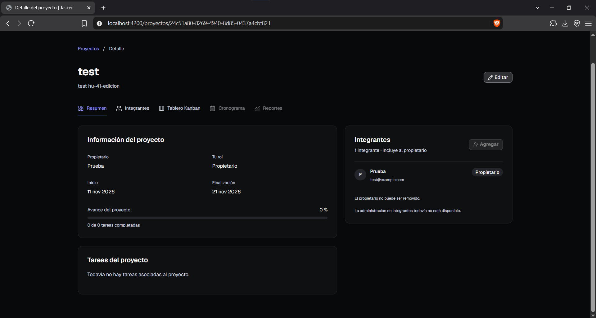
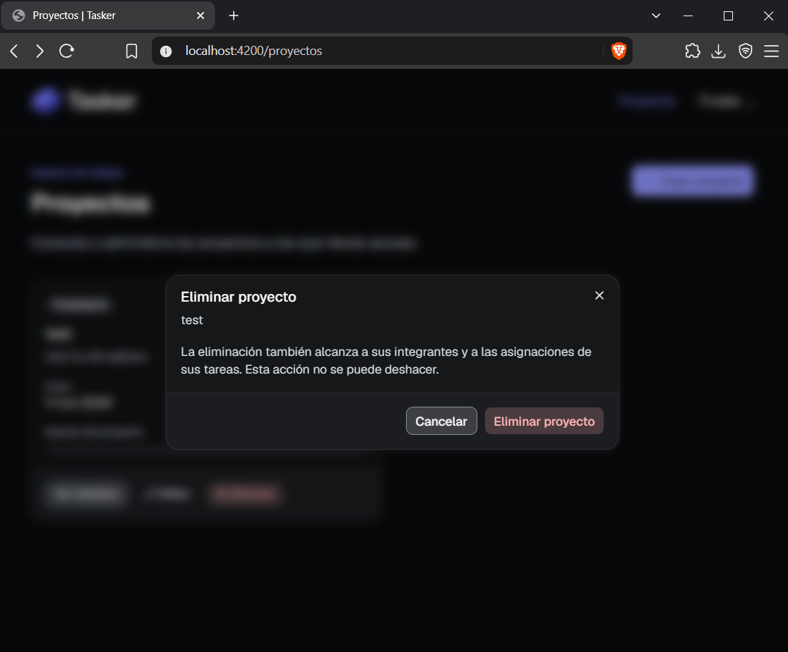

# HU-41 — Registro de ejecución de pruebas de gestión de proyectos

**Proyecto:** Tasker  
**Historia de Jira:** SCRUM-57 — HU-41  
**Enlace:** https://api-proyecto-disc01.atlassian.net/browse/SCRUM-57  
**Responsable:** QA  
**Tipo de ejecución:** Pruebas funcionales manuales  
**Versión del registro:** 1.1  
**Fecha de actualización:** 12 de noviembre de 2026  
**Fecha y hora de ejecución:** Pendientes de registrar según las ejecuciones realizadas  
**Ejecutor:** Responsable de QA  
**Rama y commit del frontend probado:** Pendientes de registrar  
**Aplicación:** Angular, `http://localhost:4200`  
**Backend:** Supabase alojado, compartido por el equipo  
**Sistema operativo:** Windows  
**Navegador y versión:** Pendientes de registrar  
**Plan de referencia:** HU-39 — Plan Maestro de Pruebas  
**Datos de referencia:** HU-53 — DS-00, DS-01, DS-02, DS-03, DS-04 y DS-05  
**Estado:** Ejecución parcial con cinco funcionalidades aprobadas

## 1. Objetivo

Documentar los resultados de las pruebas funcionales de gestión de proyectos de Tasker, conforme a los criterios de aceptación de HU-41.

Las pruebas comprenden la creación, consulta, edición y eliminación de proyectos, las validaciones de formularios, los permisos del propietario y la administración de integrantes, incluyendo las restricciones definidas en HU-51.

Los resultados se registran mediante las fichas de ejecución establecidas en el Anexo A del Plan Maestro de Pruebas HU-39, relacionando los escenarios con los datasets definidos en HU-53.

## 2. Alcance y condiciones de ejecución

Las pruebas se realizaron manualmente desde la aplicación Angular conectada al Supabase compartido del equipo.

Durante la ejecución inicial se aprobaron las funcionalidades de creación de proyectos, edición y validación de formularios.

Posteriormente, el equipo implementó las funcionalidades de consulta y eliminación de proyectos. QA confirmó su ejecución y aprobación, por lo que los casos CP-PRO-02 y CP-PRO-04 se actualizan a estado aprobado en esta versión del registro.

Las funcionalidades relacionadas con los permisos del propietario y la administración de integrantes continúan sin estar disponibles para su validación funcional completa. Por ello, los casos correspondientes se mantienen bloqueados.

El registro inicial cuenta con tres capturas, asociadas a creación, edición y validación de formularios. Para consulta y eliminación se reservan dos nuevas referencias de evidencia, cuya incorporación al repositorio deberá comprobarse.

No se ha confirmado la ejecución previa de los scripts de restauración de HU-53. Las referencias DS identifican los datos requeridos por cada escenario, sin afirmar que todos los fixtures fueron restaurados antes de las pruebas.

## 3. Matriz de trazabilidad

| Criterio de aceptación | Caso de prueba | Dataset | Estado |
|---|---|---|---|
| Creación de proyectos | CP-PRO-01 | DS-00, DS-01 | Aprobado |
| Consulta de proyectos | CP-PRO-02 | DS-02 | Aprobado |
| Edición de proyectos | CP-PRO-03 | DS-02 | Aprobado |
| Eliminación de proyectos | CP-PRO-04 | DS-02 | Aprobado |
| Acceso y restricciones sobre proyectos ajenos | CP-PRO-05 | DS-02, DS-03 | Bloqueado |
| Validaciones de formularios | EXT-PRO-01 | DS-05 | Aprobado |
| Agregar integrantes | CP-INT-01 | DS-01, DS-03 | Bloqueado |
| Asignación de tareas a integrantes | CP-INT-02 | DS-03, DS-04 | Bloqueado |
| Quitar integrantes | CP-INT-03 | DS-03 | Bloqueado |
| Administración de integrantes sin permisos | CP-INT-04 | DS-03 | Bloqueado |
| Registro de defectos | Sección 6 | — | Documentado |

Los casos CP-PRO-01 a CP-PRO-05 y CP-INT-01 a CP-INT-04 corresponden al inventario original de HU-39.

CP-INT-02 también está relacionado con HU-42 y su ejecución deberá coordinarse con las pruebas de asignación de tareas.

EXT-PRO-01 es un caso complementario utilizado para documentar de manera independiente las validaciones de formularios. No se incorpora al total original de 45 casos de HU-39 sin aprobación de la ampliación.

## 4. Fichas de ejecución

### CP-PRO-01 — Creación de proyectos

**Historia:** SCRUM-57 / HU-41  
**Módulo:** Gestión de proyectos  
**Prioridad:** Alta  
**Estado:** Aprobado

| Campo | Registro |
|---|---|
| ID del caso / historia | CP-PRO-01 / HU-41 |
| Módulo y prioridad | Gestión de proyectos / Alta |
| Ejecutado por / fecha y hora | QA / fecha y hora pendientes de registrar |
| Build / commit / navegador | Commit y versión del navegador pendientes |
| Entorno / dataset | Angular y Supabase compartido / DS-00, DS-01 |
| Precondiciones | Usuario autenticado y formulario de creación disponible |
| Resultado esperado | El sistema permite crear un proyecto con datos válidos y conserva la información registrada |
| Resultado observado | QA confirmó que la creación de proyectos funciona correctamente y aprobó el caso |
| Estado | Aprobado |
| Evidencia | EV-HU41-01 — creación de proyecto |
| Defectos | No se reportaron |
| Observaciones | Confirmar la persistencia después de recargar, si esta comprobación no fue realizada |

**Procedimiento de prueba:**

1. Iniciar sesión con una cuenta de prueba autorizada.
2. Acceder al formulario de creación de proyectos.
3. Completar los campos requeridos con datos válidos.
4. Seleccionar la opción para crear el proyecto.
5. Verificar que la aplicación confirme la operación o muestre el proyecto creado.
6. Comprobar que los datos registrados sean correctos.
7. Verificar su persistencia después de recargar la aplicación.

**Resultado:** Aprobado según la ejecución reportada por QA.

La evidencia disponible corresponde a una captura de la creación del proyecto. No se declara verificada la persistencia tras recargar si no se registró esa comprobación.

### CP-PRO-02 — Consulta de proyectos

**Historia:** SCRUM-57 / HU-41  
**Módulo:** Gestión de proyectos  
**Prioridad:** Alta  
**Estado:** Aprobado

| Campo | Registro |
|---|---|
| ID del caso / historia | CP-PRO-02 / HU-41 |
| Módulo y prioridad | Gestión de proyectos / Alta |
| Ejecutado por / fecha y hora | QA / fecha y hora pendientes de registrar |
| Build / commit / navegador | Commit y versión del navegador pendientes |
| Entorno / dataset | Angular y Supabase compartido / DS-02 |
| Precondiciones | Usuario autenticado con acceso a proyectos existentes |
| Resultado esperado | El usuario puede consultar los proyectos autorizados y visualizar correctamente la información disponible |
| Resultado observado | La funcionalidad de consulta fue implementada y QA confirmó su funcionamiento satisfactorio |
| Estado | Aprobado |
| Evidencia | EV-HU41-04 — consulta de proyectos, pendiente de incorporar al repositorio |
| Defectos | No se reportaron |
| Observaciones | Registrar la pantalla y los datos específicos comprobados durante la consulta |

**Procedimiento de prueba:**

1. Iniciar sesión con un usuario que tenga proyectos asociados.
2. Acceder a la sección de proyectos.
3. Utilizar la funcionalidad de consulta disponible.
4. Comprobar que la aplicación muestre los proyectos correspondientes al usuario.
5. Seleccionar un proyecto, cuando la interfaz permita consultar su detalle.
6. Verificar que la información visualizada corresponda al proyecto seleccionado.
7. Comprobar que la consulta funcione correctamente después de actualizar la pantalla, cuando corresponda.

**Resultado:** Aprobado según la ejecución reportada por QA.

**Actualización de la versión 1.1:** El caso deja de estar bloqueado porque la consulta ya fue implementada y aprobada.

La aprobación funcional reportada no sustituye la prueba independiente de acceso a proyectos ajenos, que permanece bloqueada en CP-PRO-05.

### CP-PRO-03 — Edición de proyectos

**Historia:** SCRUM-57 / HU-41  
**Módulo:** Gestión de proyectos  
**Prioridad:** Alta  
**Estado:** Aprobado

| Campo | Registro |
|---|---|
| ID del caso / historia | CP-PRO-03 / HU-41 |
| Módulo y prioridad | Gestión de proyectos / Alta |
| Ejecutado por / fecha y hora | QA / fecha y hora pendientes de registrar |
| Build / commit / navegador | Commit y versión del navegador pendientes |
| Entorno / dataset | Angular y Supabase compartido / DS-02 |
| Precondiciones | Proyecto existente y usuario con acceso a su edición |
| Resultado esperado | El sistema permite modificar los campos autorizados y guardar los cambios |
| Resultado observado | QA confirmó que la edición funciona correctamente y aprobó el caso |
| Estado | Aprobado |
| Evidencia | EV-HU41-02 — edición de proyecto |
| Defectos | No se reportaron |
| Observaciones | La verificación de permisos de edición sigue pendiente |

**Procedimiento de prueba:**

1. Iniciar sesión con una cuenta de prueba.
2. Acceder a un proyecto existente.
3. Abrir el formulario de edición.
4. Modificar un dato permitido.
5. Guardar los cambios.
6. Comprobar que la aplicación muestre la información actualizada.
7. Verificar la persistencia de los cambios después de recargar, cuando corresponda.

**Resultado:** Aprobado según QA.

La aprobación de la edición funcional no demuestra que las cuentas sin permisos tengan restringida esta operación.

### CP-PRO-04 — Eliminación de proyectos

**Historia:** SCRUM-57 / HU-41  
**Módulo:** Gestión de proyectos  
**Prioridad:** Media  
**Estado:** Aprobado

| Campo | Registro |
|---|---|
| ID del caso / historia | CP-PRO-04 / HU-41 |
| Módulo y prioridad | Gestión de proyectos / Media |
| Ejecutado por / fecha y hora | QA / fecha y hora pendientes de registrar |
| Build / commit / navegador | Commit y versión del navegador pendientes |
| Entorno / dataset | Angular y Supabase compartido / DS-02 |
| Precondiciones | Proyecto descartable de prueba disponible y funcionalidad de eliminación implementada |
| Resultado esperado | El sistema permite eliminar el proyecto seleccionado mediante el procedimiento autorizado y refleja correctamente el resultado |
| Resultado observado | La funcionalidad de eliminación fue implementada y QA confirmó su ejecución satisfactoria |
| Estado | Aprobado |
| Evidencia | EV-HU41-05 — eliminación de proyecto, pendiente de incorporar al repositorio |
| Defectos | No se reportaron |
| Observaciones | Registrar el proyecto descartable utilizado y la comprobación posterior a la eliminación |

**Procedimiento de prueba:**

1. Iniciar sesión con una cuenta autorizada para la operación funcional.
2. Acceder a un proyecto descartable destinado a pruebas.
3. Seleccionar la opción de eliminar proyecto.
4. Comprobar el mecanismo de confirmación, si está contemplado en la interfaz.
5. Confirmar la eliminación.
6. Verificar que el proyecto eliminado deje de aparecer como disponible.
7. Comprobar el resultado después de actualizar la vista.

**Resultado:** Aprobado según la ejecución reportada por QA.

**Actualización de la versión 1.1:** El caso deja de estar bloqueado porque la eliminación ya fue implementada y aprobada.

La eliminación funcional no demuestra por sí sola que un usuario no propietario tenga impedida esta operación. Los permisos correspondientes siguen pendientes de validación.

### CP-PRO-05 — Acceso a proyectos ajenos

**Historia:** SCRUM-57 / HU-41  
**Módulo:** Gestión de proyectos y seguridad  
**Prioridad:** Crítica  
**Estado:** Bloqueado

| Campo | Registro |
|---|---|
| ID del caso / historia | CP-PRO-05 / HU-41 |
| Módulo y prioridad | Gestión de proyectos y seguridad / Crítica |
| Ejecutado por / fecha y hora | QA / no ejecutado |
| Build / commit / navegador | Versión evaluada; commit pendiente |
| Entorno / dataset | Angular y Supabase compartido / DS-02, DS-03 |
| Precondiciones | Proyectos con propietarios distintos y cuenta externa al proyecto evaluado |
| Resultado esperado | Los usuarios ajenos no pueden acceder ni modificar información privada de proyectos sin autorización |
| Resultado observado | Aunque la consulta y eliminación están implementadas, QA informó que las restricciones de propietario todavía no están disponibles para una validación funcional completa |
| Estado | Bloqueado |
| Evidencia | No disponible |
| Defectos | No se confirmó defecto de seguridad mediante ejecución |
| Observaciones | Coordinar la prueba de permisos y políticas RLS con backend |

**Procedimiento pendiente:**

1. Preparar proyectos con propietarios diferentes.
2. Iniciar sesión con un usuario ajeno al proyecto evaluado.
3. Intentar consultar su información restringida.
4. Intentar acceder a las operaciones de modificación o eliminación, cuando corresponda.
5. Verificar que la interfaz rechace las operaciones no autorizadas.
6. Comprobar mediante una sesión no privilegiada que Supabase también aplique las restricciones correspondientes.

**Resultado:** No ejecutado.

La disponibilidad de las operaciones de consulta y eliminación no implica que estén implementados o comprobados sus controles de autorización.

### EXT-PRO-01 — Validaciones de formularios de proyectos

**Historia:** SCRUM-57 / HU-41  
**Módulo:** Formularios de proyectos  
**Prioridad:** Alta, caso complementario  
**Estado:** Aprobado

| Campo | Registro |
|---|---|
| ID del caso / historia | EXT-PRO-01 / HU-41 |
| Módulo y prioridad | Formularios de proyectos / Alta |
| Ejecutado por / fecha y hora | QA / fecha y hora pendientes de registrar |
| Build / commit / navegador | Commit y versión del navegador pendientes |
| Entorno / dataset | Angular y Supabase compartido / DS-05 |
| Precondiciones | Formulario de proyectos disponible |
| Resultado esperado | El formulario aplica las validaciones definidas y no acepta indebidamente datos inválidos |
| Resultado observado | QA confirmó que las validaciones están implementadas y reportó un resultado satisfactorio |
| Estado | Aprobado |
| Evidencia | EV-HU41-03 — validación de formulario |
| Defectos | No se reportaron |
| Observaciones | Identificar en el registro el campo validado y el resultado concreto mostrado por la aplicación |

**Procedimiento de prueba:**

1. Acceder al formulario de creación o edición de proyectos.
2. Introducir un valor que incumpla una regla de validación.
3. Intentar enviar o guardar el formulario.
4. Comprobar el comportamiento de la interfaz.
5. Verificar que no se acepte indebidamente la operación inválida.

**Resultado:** Aprobado según QA.

La aprobación corresponde a las validaciones ejecutadas. No se afirma que todas las posibles entradas límite hayan sido comprobadas.

Los valores máximos de longitud deberán contrastarse con las reglas reales de Angular o Jira. El esquema PostgreSQL utiliza campos `text` sin longitudes máximas explícitas para los campos relacionados.

### CP-INT-01 — Agregar integrantes a un proyecto

**Historia:** SCRUM-57 / HU-41, relacionada con HU-51  
**Módulo:** Integrantes de proyectos  
**Prioridad:** Alta  
**Estado:** Bloqueado

| Campo | Registro |
|---|---|
| ID del caso / historia | CP-INT-01 / HU-41 |
| Módulo y prioridad | Integrantes / Alta |
| Ejecutado por / fecha y hora | QA / no ejecutado |
| Entorno / dataset | Angular y Supabase compartido / DS-01, DS-03 |
| Precondiciones | Proyecto existente, cuenta propietaria y usuario disponible |
| Resultado esperado | El propietario puede agregar integrantes y la membresía queda registrada |
| Resultado observado | QA informó que la incorporación de integrantes todavía no está implementada |
| Estado | Bloqueado |
| Evidencia | No disponible |
| Defectos | No aplica; escenario sin ejecución |
| Próxima acción | Ejecutar cuando esté disponible la funcionalidad de HU-51 |

**Procedimiento pendiente:**

1. Iniciar sesión como propietario.
2. Abrir un proyecto de prueba.
3. Acceder a la administración de integrantes.
4. Seleccionar un usuario de prueba.
5. Incorporarlo al proyecto.
6. Verificar la membresía creada y su persistencia.

**Resultado:** No ejecutado.

### CP-INT-02 — Asignación de tareas a integrantes

**Historia:** Relacionada con HU-41 y HU-42  
**Módulo:** Integrantes y asignaciones  
**Prioridad:** Alta  
**Estado:** Bloqueado

| Campo | Registro |
|---|---|
| ID del caso / historia | CP-INT-02 / HU-41, HU-42 |
| Módulo y prioridad | Integrantes y asignaciones / Alta |
| Ejecutado por / fecha y hora | QA / no ejecutado dentro de HU-41 |
| Entorno / dataset | Angular y Supabase compartido / DS-03, DS-04 |
| Precondiciones | Proyecto con integrantes y tarea disponible |
| Resultado esperado | La asignación de un responsable válido se registra y persiste |
| Resultado observado | No se ejecutó el escenario en HU-41 por la falta de disponibilidad de las funciones relacionadas con integrantes |
| Estado | Bloqueado |
| Evidencia | No disponible |
| Defectos | No aplica; escenario sin ejecución |
| Próxima acción | Coordinar su ejecución con HU-42 cuando estén disponibles las funciones necesarias |

**Procedimiento pendiente:**

1. Preparar un proyecto con integrantes.
2. Acceder a una tarea.
3. Seleccionar a un responsable autorizado.
4. Guardar la asignación.
5. Comprobar que la relación se conserva correctamente.

**Resultado:** No ejecutado.

Se mantiene este caso por trazabilidad con HU-39, considerando que también corresponde al alcance de HU-42.

### CP-INT-03 — Quitar integrantes de un proyecto

**Historia:** SCRUM-57 / HU-41, relacionada con HU-51  
**Módulo:** Integrantes de proyectos  
**Prioridad:** Media  
**Estado:** Bloqueado

| Campo | Registro |
|---|---|
| ID del caso / historia | CP-INT-03 / HU-41 |
| Módulo y prioridad | Integrantes / Media |
| Ejecutado por / fecha y hora | QA / no ejecutado |
| Entorno / dataset | Angular y Supabase compartido / DS-03 |
| Precondiciones | Proyecto con integrantes y cuenta propietaria |
| Resultado esperado | El propietario puede retirar integrantes y se actualizan correctamente las membresías |
| Resultado observado | QA informó que la eliminación de integrantes todavía no está implementada |
| Estado | Bloqueado |
| Evidencia | No disponible |
| Defectos | No aplica; escenario sin ejecución |
| Próxima acción | Ejecutar cuando esté disponible la administración de integrantes |

**Procedimiento pendiente:**

1. Iniciar sesión con la cuenta propietaria.
2. Acceder al listado de integrantes del proyecto.
3. Seleccionar un integrante de prueba.
4. Solicitar su retiro.
5. Confirmar la operación cuando corresponda.
6. Verificar que la membresía fue retirada.

**Resultado:** No ejecutado.

### CP-INT-04 — Administración de integrantes por usuario no autorizado

**Historia:** SCRUM-57 / HU-41, relacionada con HU-51  
**Módulo:** Integrantes y seguridad  
**Prioridad:** Crítica  
**Estado:** Bloqueado

| Campo | Registro |
|---|---|
| ID del caso / historia | CP-INT-04 / HU-41 |
| Módulo y prioridad | Integrantes y seguridad / Crítica |
| Ejecutado por / fecha y hora | QA / no ejecutado |
| Entorno / dataset | Angular y Supabase compartido / DS-03 |
| Precondiciones | Proyecto con propietario e integrante sin permisos de propietario |
| Resultado esperado | Los usuarios no propietarios no pueden agregar ni quitar integrantes |
| Resultado observado | Las funciones y restricciones correspondientes a la administración de integrantes todavía no están disponibles para su comprobación |
| Estado | Bloqueado |
| Evidencia | No disponible |
| Defectos | No se confirmó ningún defecto de autorización |
| Próxima acción | Ejecutar pruebas de interfaz y RLS cuando se integre HU-51 |

**Procedimiento pendiente:**

1. Preparar un proyecto con propietario e integrante.
2. Iniciar sesión con una cuenta que no sea propietaria.
3. Intentar agregar otro integrante.
4. Intentar quitar un integrante existente.
5. Verificar que ambas operaciones sean rechazadas.
6. Comprobar que las membresías originales no se modificaron.

**Resultado:** No ejecutado.

## 5. Resumen de ejecución

### 5.1. Casos originales de HU-39 relacionados con HU-41

| Estado | Cantidad | Casos |
|---|---:|---|
| Aprobados | 4 | CP-PRO-01, CP-PRO-02, CP-PRO-03, CP-PRO-04 |
| Bloqueados | 5 | CP-PRO-05, CP-INT-01, CP-INT-02, CP-INT-03, CP-INT-04 |
| Fallidos | 0 | Ninguno confirmado |
| Total | 9 | — |

De los nueve casos originales relacionados con la gestión de proyectos e integrantes, cuatro fueron aprobados según QA y cinco permanecen bloqueados.

### 5.2. Caso complementario

| Caso | Escenario | Estado |
|---|---|---|
| EXT-PRO-01 | Validaciones de formularios | Aprobado |

EXT-PRO-01 se registra por separado y no modifica el total de los casos originales de HU-39.

### 5.3. Resultado por funcionalidad

| Funcionalidad | Resultado |
|---|---|
| Creación de proyectos | Aprobada |
| Consulta de proyectos | Aprobada |
| Edición de proyectos | Aprobada |
| Eliminación de proyectos | Aprobada |
| Validaciones de formularios | Aprobada |
| Acceso restringido a proyectos ajenos | Bloqueada |
| Incorporación de integrantes | Bloqueada |
| Asignación de tareas a integrantes | Bloqueada dentro de HU-41 |
| Retiro de integrantes | Bloqueada |
| Restricción de administración a usuarios no propietarios | Bloqueada |

**Resultado general:** cinco funcionalidades o escenarios con resultados favorables y cinco casos pendientes de ejecución por falta de implementación de permisos e integrantes.

No se calcula una tasa de aprobación global definitiva de HU-41 porque permanecen criterios de aceptación sin verificar.

## 6. Registro de defectos y bloqueos

### 6.1. Defectos confirmados

No se reportaron defectos funcionales confirmados en las pruebas ejecutadas.

La aprobación de creación, consulta, edición, eliminación y validaciones de formularios se registra conforme a los resultados comunicados por QA.

No se crean identificadores ficticios de defectos en Jira.

### 6.2. Funcionalidades bloqueadas

| Bloqueo | Casos afectados | Situación |
|---|---|---|
| Restricciones de acceso y permisos del propietario | CP-PRO-05 | Pendientes de implementación o validación |
| Incorporación de integrantes | CP-INT-01 | No implementada |
| Asignación de tareas a integrantes | CP-INT-02 | No ejecutada en HU-41; vinculada con HU-42 |
| Retiro de integrantes | CP-INT-03 | No implementada |
| Administración por usuarios no propietarios | CP-INT-04 | No implementada o no verificable mediante el flujo actual |

Las funcionalidades de consulta y eliminación ya no se incluyen entre los bloqueos, porque fueron implementadas y aprobadas.

Los casos bloqueados no se contabilizan como fallidos. Su clasificación definitiva como tareas pendientes, dependencias o defectos deberá determinarse conforme al estado de las historias de implementación en Jira.

## 7. Inventario de evidencias

| ID | Evidencia | Caso relacionado | Situación |
|---|---|---|---|
| EV-HU41-01 | Creación de proyecto | CP-PRO-01 | Captura disponible |
| EV-HU41-02 | Edición de proyecto | CP-PRO-03 | Captura disponible |
| EV-HU41-03 | Validación de formulario | EXT-PRO-01 | Captura disponible |
| EV-HU41-04 | Consulta de proyectos | CP-PRO-02 | Captura disponible |
| EV-HU41-05 | Eliminación de proyecto | CP-PRO-04 | Captura disponible |

### 7.1. Ubicación en el repositorio

Las capturas se almacenarán en:

`docs/qa/evidencias/hu-41/`

Nombres establecidos:

- `EV-HU41-01-creacion-proyecto.png`
- `EV-HU41-02-edicion-proyecto.png`
- `EV-HU41-03-validacion-formulario.png`
- `EV-HU41-04-consulta-proyecto.png`
- `EV-HU41-05-eliminacion-proyecto.png`

Si las capturas reales están en formato JPG, se debe conservar su extensión correspondiente y actualizar los enlaces.

### 7.2. Evidencias visuales

**EV-HU41-01 — Creación de proyecto**

**EV-HU41-02 — Edición de proyecto**

**EV-HU41-03 — Validación de formulario**

**EV-HU41-04 — Consulta de proyectos**

**EV-HU41-05 — Eliminación de proyecto**

## 8. Dependencias y acciones pendientes

1. Implementar o habilitar las restricciones de acceso que permitan verificar los permisos del propietario.
2. Implementar las operaciones de agregar y quitar integrantes conforme a HU-51.
3. Verificar que solamente el propietario pueda administrar los integrantes.
4. Comprobar el acceso a proyectos ajenos mediante la interfaz y las políticas RLS de Supabase.
5. Coordinar la asignación de responsables con las pruebas de HU-42.
6. Ejecutar nuevamente los cinco casos bloqueados cuando estén disponibles las funcionalidades correspondientes.
7. Incorporar las evidencias EV-HU41-04 y EV-HU41-05 de consulta y eliminación.
8. Registrar la fecha, hora, rama y commit del frontend utilizado en las pruebas.
9. Confirmar las comprobaciones de persistencia y resultados posteriores a la recarga cuando no se hayan registrado.
10. Incorporar en Jira los defectos que se detecten durante las próximas ejecuciones.

## 9. Estado de HU-41

**Estado:** ejecución parcial actualizada.

Las funcionalidades de creación, consulta, edición, eliminación y validaciones de formularios fueron reportadas como implementadas, probadas y aprobadas por QA.

La consulta y eliminación dejaron de ser bloqueos en la versión 1.1 del registro.

Los casos relacionados con permisos de propietario, acceso a proyectos ajenos y administración de integrantes permanecen bloqueados por no estar implementadas o disponibles las funcionalidades necesarias para su validación.

No se reportaron defectos confirmados en las pruebas ejecutadas.

El documento puede incorporarse al repositorio y presentarse a revisión como registro actualizado. La historia todavía no debe declararse completamente aprobada, porque permanecen criterios de aceptación pendientes.
 bloqueados. Se registraron tres evidencias disponibles. |
| 1.1 | 12/11/2026 | Actualización de CP-PRO-02 y CP-PRO-04 como aprobados por implementación y validación de consulta y eliminación. Se actualizó la matriz de trazabilidad, las fichas, el resumen de ejecución, los bloqueos y el inventario de evidencias. Permanecen pendientes las pruebas de permisos e integrantes. |
