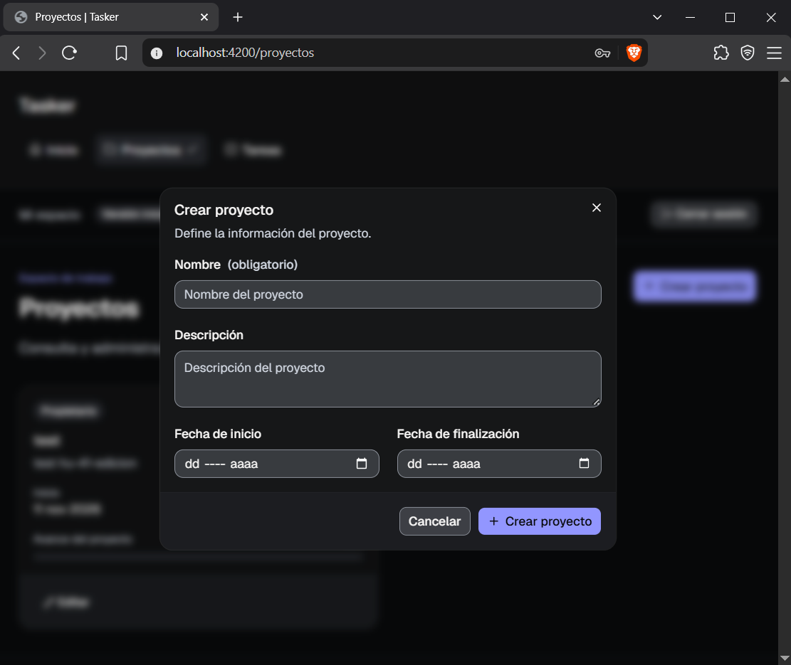
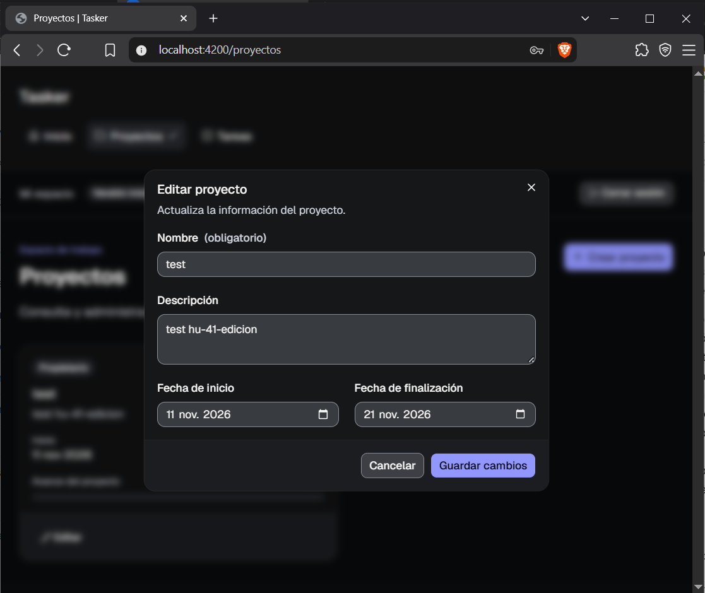
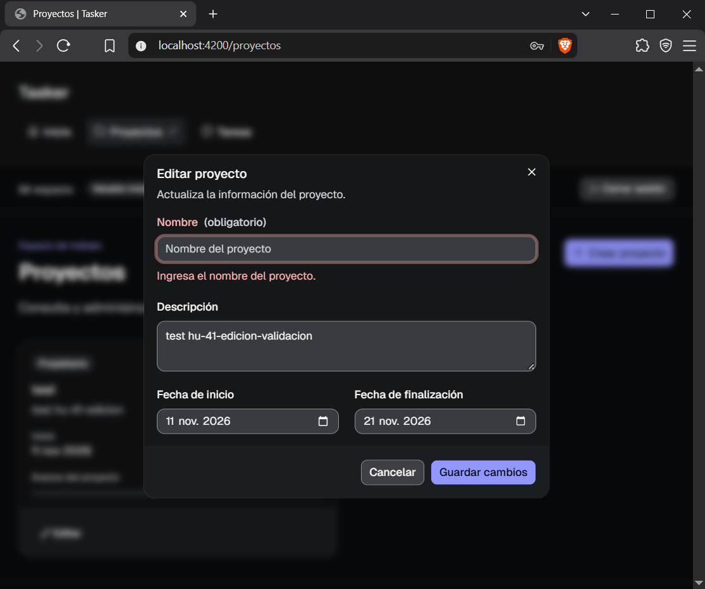

# HU-41 — Registro de ejecución de pruebas de gestión de proyectos

**Proyecto:** Tasker  
**Historia de Jira:** SCRUM-57 — HU-41  
**Enlace:** https://api-proyecto-disc01.atlassian.net/browse/SCRUM-57  
**Responsable:** QA  
**Tipo de ejecución:** Pruebas funcionales manuales  
**Versión del registro:** 1.0  
**Fecha de elaboración:** 11 de noviembre de 2026  
**Fecha y hora de ejecución:** Pendientes de registrar  
**Ejecutor:** Responsable de QA  
**Rama y commit del frontend probado:** Pendientes de registrar  
**Aplicación:** Angular, `http://localhost:4200`  
**Backend:** Supabase alojado, compartido por el equipo  
**Sistema operativo:** Windows  
**Navegador y versión:** Pendientes de registrar  
**Plan de referencia:** HU-39 — Plan Maestro de Pruebas  
**Datos de referencia:** HU-53 — DS-00, DS-01, DS-02, DS-03, DS-04 y DS-05  
**Estado:** Ejecución parcial

## 1. Objetivo

Registrar la ejecución de las pruebas funcionales de gestión de proyectos de Tasker, de acuerdo con los criterios de aceptación de HU-41.

El alcance comprende creación, consulta, edición, eliminación, validaciones de formularios, permisos del propietario y administración de integrantes, incluyendo las restricciones establecidas por HU-51.

Las pruebas se documentan mediante las fichas del Anexo A del Plan Maestro de Pruebas HU-39, vinculando los casos a los datasets definidos en HU-53.

## 2. Alcance y condiciones de ejecución

Las pruebas se realizaron manualmente desde la aplicación Angular conectada al servicio compartido de Supabase.

Según los resultados comunicados por QA, las funcionalidades de creación de proyectos, edición y validación de formularios están implementadas y fueron aprobadas durante la ejecución.

Las funcionalidades de consulta independiente de proyectos, eliminación, verificación de permisos del propietario y administración de integrantes no están implementadas en la versión evaluada, por lo que sus casos correspondientes permanecen bloqueados.

Se dispone de una captura para cada una de las tres funcionalidades aprobadas. Las capturas no se han incorporado todavía a este registro y deberán adjuntarse en el repositorio.

No se ha confirmado la restauración previa de los datasets SQL de HU-53. Por tanto, las referencias DS indican los datos requeridos por cada caso, sin afirmar que todos los fixtures fueron cargados durante esta ejecución.

## 3. Matriz de trazabilidad

| Criterio de aceptación | Caso de prueba | Dataset | Estado |
|---|---|---|---|
| Creación de proyectos | CP-PRO-01 | DS-00, DS-01 | Aprobado |
| Consulta de proyectos | CP-PRO-02 | DS-02 | Bloqueado |
| Edición de proyectos | CP-PRO-03 | DS-02 | Aprobado |
| Eliminación de proyectos | CP-PRO-04 | DS-02 | Bloqueado |
| Acceso a proyectos ajenos | CP-PRO-05 | DS-02, DS-03 | Bloqueado |
| Validación de formularios | EXT-PRO-01 | DS-05 | Aprobado |
| Agregar integrantes | CP-INT-01 | DS-01, DS-03 | Bloqueado |
| Asignación de tareas a integrantes | CP-INT-02 | DS-03, DS-04 | Bloqueado |
| Quitar integrantes | CP-INT-03 | DS-03 | Bloqueado |
| Administración de integrantes sin permisos | CP-INT-04 | DS-03 | Bloqueado |
| Registro de defectos | Sección 6 de este documento | — | Documentado |

Los casos CP-PRO-01 a CP-PRO-05 y CP-INT-01 a CP-INT-04 pertenecen al inventario original de HU-39.

CP-INT-02 es un caso relacionado también con HU-42, por lo que su ejecución deberá coordinarse con las pruebas de asignación de tareas.

EXT-PRO-01 es una ampliación documental para identificar de manera independiente las validaciones de formularios. No se incorpora a los 45 casos originales de HU-39 sin la aprobación correspondiente.

## 4. Fichas de ejecución

### CP-PRO-01 — Creación de proyectos

**Historia:** SCRUM-57 / HU-41  
**Módulo:** Gestión de proyectos  
**Prioridad:** Alta  
**Estado:** Aprobado según ejecución reportada por QA

| Campo | Registro |
|---|---|
| ID del caso / historia | CP-PRO-01 / HU-41 |
| Módulo y prioridad | Gestión de proyectos / Alta |
| Ejecutado por / fecha y hora | QA / fecha y hora pendientes de registrar |
| Build / commit / navegador | Commit y versión del navegador pendientes |
| Entorno / versión del dataset | Angular y Supabase compartido / DS-00, DS-01 (HU-53 QA53-1.2) |
| Precondiciones | Usuario autenticado y formulario de creación disponible |
| Pasos ejecutados | Acceso al formulario, ingreso de datos válidos, envío y comprobación del resultado |
| Resultado esperado | El proyecto se crea correctamente, aparece en la aplicación y conserva sus datos después de recargar |
| Resultado observado | QA confirmó que la creación de proyectos funciona correctamente y reportó el caso como aprobado |
| Estado | Aprobado |
| Evidencia / defecto | EV-HU41-01 / sin defecto reportado |
| Observaciones / próxima acción | Incorporar captura; confirmar persistencia después de recargar si todavía no se verificó |

**Procedimiento de prueba:**

1. Iniciar sesión con una cuenta de prueba autorizada.
2. Acceder al formulario de creación de proyectos.
3. Completar los campos obligatorios con datos válidos.
4. Seleccionar la opción para guardar o crear el proyecto.
5. Comprobar que la aplicación confirme la operación o muestre el proyecto creado.
6. Verificar su persistencia después de recargar la página.

**Resultado registrado:** Aprobado según QA. La captura disponible respalda el resultado visual de la operación; la persistencia tras recargar debe confirmarse con evidencia o registro de ejecución si no fue comprobada.

### CP-PRO-02 — Consulta de proyectos

**Historia:** SCRUM-57 / HU-41  
**Módulo:** Gestión de proyectos  
**Prioridad:** Alta  
**Estado:** Bloqueado

| Campo | Registro |
|---|---|
| ID del caso / historia | CP-PRO-02 / HU-41 |
| Módulo y prioridad | Gestión de proyectos / Alta |
| Ejecutado por / fecha y hora | QA / no ejecutado |
| Build / commit / navegador | Versión evaluada; commit pendiente |
| Entorno / versión del dataset | Angular y Supabase compartido / DS-02 |
| Precondiciones | Usuario autenticado con proyectos asociados |
| Pasos previstos | Acceder al listado, seleccionar un proyecto y consultar sus datos |
| Resultado esperado | Se muestran los proyectos autorizados y el detalle seleccionado con información correcta |
| Resultado observado | QA informó que la funcionalidad de consulta de proyectos no está implementada |
| Estado | Bloqueado |
| Evidencia / defecto | No disponible / dependencia de implementación |
| Observaciones / próxima acción | Ejecutar cuando se encuentre disponible la consulta de lista y detalle |

**Procedimiento pendiente:**

1. Iniciar sesión con una cuenta autorizada.
2. Acceder al listado de proyectos.
3. Verificar los proyectos visibles.
4. Seleccionar un proyecto.
5. Revisar sus datos.
6. Comprobar la información después de actualizar la vista.

**Resultado registrado:** No ejecutado por ausencia de la funcionalidad de consulta.

La posibilidad de abrir un formulario de edición no sustituye automáticamente la prueba de consulta de listado y detalle.

### CP-PRO-03 — Edición de proyectos

**Historia:** SCRUM-57 / HU-41  
**Módulo:** Gestión de proyectos  
**Prioridad:** Alta  
**Estado:** Aprobado según ejecución reportada por QA

| Campo | Registro |
|---|---|
| ID del caso / historia | CP-PRO-03 / HU-41 |
| Módulo y prioridad | Gestión de proyectos / Alta |
| Ejecutado por / fecha y hora | QA / fecha y hora pendientes de registrar |
| Build / commit / navegador | Commit y versión del navegador pendientes |
| Entorno / versión del dataset | Angular y Supabase compartido / DS-02 |
| Precondiciones | Proyecto existente y usuario con acceso a su edición |
| Pasos ejecutados | Acceso al formulario de edición, modificación de datos y guardado |
| Resultado esperado | Los cambios permitidos se guardan y se mantienen después de recargar |
| Resultado observado | QA confirmó el funcionamiento de la edición de proyectos y reportó el caso como aprobado |
| Estado | Aprobado |
| Evidencia / defecto | EV-HU41-02 / sin defecto reportado |
| Observaciones / próxima acción | Incorporar captura y confirmar persistencia de cambios cuando corresponda |

**Procedimiento de prueba:**

1. Iniciar sesión con una cuenta de prueba.
2. Acceder a un proyecto existente.
3. Abrir el formulario de edición.
4. Modificar un dato permitido del proyecto.
5. Guardar los cambios.
6. Comprobar el resultado mostrado.
7. Recargar la página y verificar que el dato actualizado se conserva.

**Resultado registrado:** Aprobado según QA.

La comprobación de edición funcional no demuestra por sí sola que los usuarios sin permisos tengan prohibido editar. Esa restricción continúa pendiente de prueba.

### CP-PRO-04 — Eliminación de proyectos

**Historia:** SCRUM-57 / HU-41  
**Módulo:** Gestión de proyectos  
**Prioridad:** Media  
**Estado:** Bloqueado

| Campo | Registro |
|---|---|
| ID del caso / historia | CP-PRO-04 / HU-41 |
| Módulo y prioridad | Gestión de proyectos / Media |
| Ejecutado por / fecha y hora | QA / no ejecutado |
| Build / commit / navegador | Versión evaluada; commit pendiente |
| Entorno / versión del dataset | Angular y Supabase compartido / DS-02 |
| Precondiciones | Proyecto de prueba disponible y mecanismo de eliminación implementado |
| Pasos previstos | Solicitar eliminación, confirmar y comprobar su efecto |
| Resultado esperado | La eliminación aplica las confirmaciones y restricciones aprobadas, sin afectar datos ajenos |
| Resultado observado | QA informó que la eliminación de proyectos no está implementada |
| Estado | Bloqueado |
| Evidencia / defecto | No disponible / dependencia de implementación |
| Observaciones / próxima acción | Ejecutar cuando se implemente la eliminación, utilizando un proyecto descartable de QA |

**Procedimiento pendiente:**

1. Acceder con una cuenta autorizada.
2. Seleccionar un proyecto descartable de prueba.
3. Utilizar la opción de eliminación.
4. Comprobar el mecanismo de confirmación, si corresponde.
5. Confirmar la operación.
6. Verificar que el resultado coincide con el comportamiento aprobado.

**Resultado registrado:** No ejecutado.

No se eliminó ningún proyecto como parte de este caso.

### CP-PRO-05 — Acceso a proyectos ajenos

**Historia:** SCRUM-57 / HU-41  
**Módulo:** Gestión de proyectos y seguridad  
**Prioridad:** Crítica  
**Estado:** Bloqueado

| Campo | Registro |
|---|---|
| ID del caso / historia | CP-PRO-05 / HU-41 |
| Módulo y prioridad | Gestión de proyectos y seguridad / Crítica |
| Ejecutado por / fecha y hora | QA / no ejecutado |
| Build / commit / navegador | Versión evaluada; commit pendiente |
| Entorno / versión del dataset | Angular y Supabase compartido / DS-02, DS-03 |
| Precondiciones | Proyectos con propietarios distintos y usuario ajeno al proyecto consultado |
| Pasos previstos | Acceder con identidad externa e intentar consultar información restringida |
| Resultado esperado | El usuario ajeno no puede consultar datos privados del proyecto desde la interfaz ni mediante acceso no privilegiado a la API |
| Resultado observado | QA indicó que las funcionalidades necesarias para verificar permisos de propietario y acceso entre proyectos no están implementadas |
| Estado | Bloqueado |
| Evidencia / defecto | No disponible / dependencia de implementación |
| Observaciones / próxima acción | Coordinar pruebas de interfaz y políticas RLS con backend |

**Procedimiento pendiente:**

1. Preparar dos proyectos con propietarios distintos.
2. Iniciar sesión con una cuenta ajena a uno de los proyectos.
3. Intentar consultar la información de ese proyecto.
4. Comprobar la restricción en la interfaz.
5. Verificar, utilizando únicamente credenciales no privilegiadas, que la API tampoco expone la información restringida.

**Resultado registrado:** No ejecutado.

El hecho de no disponer de una pantalla de consulta no demuestra que las políticas RLS funcionen correctamente.

### EXT-PRO-01 — Validación de formularios de proyectos

**Historia:** SCRUM-57 / HU-41  
**Módulo:** Formularios de proyectos  
**Prioridad:** Alta, ampliación propuesta  
**Estado:** Aprobado según ejecución reportada por QA

| Campo | Registro |
|---|---|
| ID del caso / historia | EXT-PRO-01 / HU-41 |
| Módulo y prioridad | Validaciones de formularios / Alta |
| Ejecutado por / fecha y hora | QA / fecha y hora pendientes de registrar |
| Build / commit / navegador | Commit y versión del navegador pendientes |
| Entorno / versión del dataset | Angular y Supabase compartido / DS-05 |
| Precondiciones | Formulario de proyectos disponible |
| Pasos ejecutados | Se probó una validación del formulario mediante una entrada que incumple sus reglas |
| Resultado esperado | La aplicación aplica las restricciones definidas y evita el envío de valores inválidos |
| Resultado observado | QA informó que las validaciones del formulario están implementadas y reportó la prueba como aprobada |
| Estado | Aprobado |
| Evidencia / defecto | EV-HU41-03 / sin defecto reportado |
| Observaciones / próxima acción | Registrar el campo, valor inválido y mensaje exacto que aparecen en la captura |

**Procedimiento de prueba:**

1. Acceder al formulario de creación o edición de proyectos.
2. Introducir un valor que incumpla una validación definida.
3. Intentar continuar con la operación.
4. Observar la respuesta del formulario.
5. Comprobar que la operación inválida no se acepta indebidamente.

**Resultado registrado:** Aprobado según QA.

No se especifica el campo ni el mensaje exacto porque esa información no se proporcionó en el registro. Tampoco se declara que todas las reglas de validación posibles hayan sido probadas con una sola captura.

Los límites máximos de caracteres deberán contrastarse con las reglas vigentes de Angular o Jira. La migración de PostgreSQL no establece longitudes máximas explícitas para los campos de tipo `text`.

### CP-INT-01 — Agregar integrantes a un proyecto

**Historia:** SCRUM-57 / HU-41, relacionada con HU-51  
**Módulo:** Integrantes de proyectos  
**Prioridad:** Alta  
**Estado:** Bloqueado

| Campo | Registro |
|---|---|
| ID del caso / historia | CP-INT-01 / HU-41 |
| Módulo y prioridad | Integrantes / Alta |
| Ejecutado por / fecha y hora | QA / no ejecutado |
| Build / commit / navegador | Versión evaluada; commit pendiente |
| Entorno / versión del dataset | Angular y Supabase compartido / DS-01, DS-03 |
| Precondiciones | Proyecto existente, cuenta propietaria y usuario de prueba disponible |
| Pasos previstos | Agregar un integrante desde la cuenta propietaria |
| Resultado esperado | La membresía se registra y el usuario adquiere los permisos correspondientes |
| Resultado observado | QA informó que la incorporación de integrantes no está implementada |
| Estado | Bloqueado |
| Evidencia / defecto | No disponible / dependencia de HU-51 |
| Observaciones / próxima acción | Ejecutar cuando esté disponible la administración de integrantes |

**Procedimiento pendiente:**

1. Iniciar sesión como propietario.
2. Abrir un proyecto de prueba.
3. Acceder a la administración de integrantes.
4. Seleccionar un usuario de prueba.
5. Agregarlo al proyecto.
6. Verificar la membresía y su persistencia.

**Resultado registrado:** No ejecutado.

### CP-INT-02 — Asignación de tareas a integrantes

**Historia:** Relacionada con HU-41 y HU-42  
**Módulo:** Integrantes y asignaciones  
**Prioridad:** Alta  
**Estado:** Bloqueado

| Campo | Registro |
|---|---|
| ID del caso / historia | CP-INT-02 / HU-41, HU-42 |
| Módulo y prioridad | Integrantes y asignaciones / Alta |
| Ejecutado por / fecha y hora | QA / no ejecutado |
| Build / commit / navegador | Versión evaluada; commit pendiente |
| Entorno / versión del dataset | Angular y Supabase compartido / DS-03, DS-04 |
| Precondiciones | Proyecto con integrantes y tarea disponible |
| Pasos previstos | Asignar una tarea a un integrante permitido |
| Resultado esperado | La relación entre tarea y responsable se registra y persiste |
| Resultado observado | No se realizó este escenario dentro de HU-41; las funcionalidades relacionadas con integrantes se reportaron como no implementadas |
| Estado | Bloqueado |
| Evidencia / defecto | No disponible |
| Observaciones / próxima acción | Coordinar con HU-42 una vez implementadas las funcionalidades necesarias |

**Procedimiento pendiente:**

1. Preparar un proyecto con un integrante.
2. Acceder a una tarea del proyecto.
3. Seleccionar el responsable.
4. Guardar la asignación.
5. Verificar que el responsable seleccionado se mantiene.

**Resultado registrado:** No ejecutado.

Este caso se conserva por trazabilidad con HU-39 y HU-53. Su ejecución funcional corresponde también al alcance de HU-42.

### CP-INT-03 — Quitar integrantes de un proyecto

**Historia:** SCRUM-57 / HU-41, relacionada con HU-51  
**Módulo:** Integrantes de proyectos  
**Prioridad:** Media  
**Estado:** Bloqueado

| Campo | Registro |
|---|---|
| ID del caso / historia | CP-INT-03 / HU-41 |
| Módulo y prioridad | Integrantes / Media |
| Ejecutado por / fecha y hora | QA / no ejecutado |
| Build / commit / navegador | Versión evaluada; commit pendiente |
| Entorno / versión del dataset | Angular y Supabase compartido / DS-03 |
| Precondiciones | Proyecto con integrantes y cuenta propietaria |
| Pasos previstos | Retirar un integrante y verificar el efecto de la operación |
| Resultado esperado | Solo el propietario realiza la eliminación de la membresía y se aplican las restricciones correspondientes |
| Resultado observado | QA informó que la eliminación de integrantes no está implementada |
| Estado | Bloqueado |
| Evidencia / defecto | No disponible / dependencia de HU-51 |
| Observaciones / próxima acción | Ejecutar cuando se implemente la funcionalidad |

**Procedimiento pendiente:**

1. Iniciar sesión con la cuenta propietaria del proyecto.
2. Acceder al listado de integrantes.
3. Seleccionar un integrante de prueba.
4. Solicitar su eliminación del proyecto.
5. Confirmar la operación cuando corresponda.
6. Comprobar que la membresía fue retirada.

**Resultado registrado:** No ejecutado.

### CP-INT-04 — Administración de integrantes por usuario no autorizado

**Historia:** SCRUM-57 / HU-41, relacionada con HU-51  
**Módulo:** Integrantes y seguridad  
**Prioridad:** Crítica  
**Estado:** Bloqueado

| Campo | Registro |
|---|---|
| ID del caso / historia | CP-INT-04 / HU-41 |
| Módulo y prioridad | Integrantes y seguridad / Crítica |
| Ejecutado por / fecha y hora | QA / no ejecutado |
| Build / commit / navegador | Versión evaluada; commit pendiente |
| Entorno / versión del dataset | Angular y Supabase compartido / DS-03 |
| Precondiciones | Proyecto con propietario e integrante sin privilegios de propietario |
| Pasos previstos | Intentar agregar o quitar integrantes desde una cuenta no propietaria |
| Resultado esperado | El usuario no autorizado no puede administrar integrantes desde Angular ni mediante solicitudes no privilegiadas a Supabase |
| Resultado observado | QA informó que las funciones necesarias para comprobar estos permisos no están implementadas |
| Estado | Bloqueado |
| Evidencia / defecto | No disponible / dependencia de HU-51 |
| Observaciones / próxima acción | Verificar restricciones de interfaz y RLS cuando el flujo esté disponible |

**Procedimiento pendiente:**

1. Preparar un proyecto con propietario e integrante.
2. Iniciar sesión como integrante que no sea propietario.
3. Intentar agregar otro integrante.
4. Intentar retirar a un integrante existente.
5. Verificar el rechazo de las operaciones.
6. Comprobar que las membresías no se alteraron.

**Resultado registrado:** No ejecutado.

## 5. Resumen de ejecución

### 5.1. Casos originales de HU-39 relacionados con HU-41

| Estado | Cantidad | Casos |
|---|---:|---|
| Aprobados | 2 | CP-PRO-01, CP-PRO-03 |
| Bloqueados | 7 | CP-PRO-02, CP-PRO-04, CP-PRO-05, CP-INT-01, CP-INT-02, CP-INT-03, CP-INT-04 |
| Fallidos | 0 | Ninguno confirmado |
| Total | 9 | — |

De los nueve casos originales relacionados con la gestión de proyectos e integrantes, dos fueron reportados como aprobados y siete permanecen bloqueados.

CP-INT-02 comparte alcance con HU-42 y se incluye para conservar la trazabilidad definida en HU-39.

### 5.2. Caso complementario

| Caso | Escenario | Estado |
|---|---|---|
| EXT-PRO-01 | Validaciones de formularios | Aprobado |

Este caso no forma parte del inventario original de 45 casos de HU-39.

### 5.3. Resultado por funcionalidad

| Funcionalidad | Resultado |
|---|---|
| Creación de proyectos | Aprobada |
| Edición de proyectos | Aprobada |
| Validación de formularios | Aprobada |
| Consulta de proyectos | Bloqueada |
| Eliminación de proyectos | Bloqueada |
| Permisos del propietario | Bloqueada |
| Agregar integrantes | Bloqueada |
| Quitar integrantes | Bloqueada |
| Autorización de integrantes no propietarios | Bloqueada |

**Resultado general:** tres funcionalidades con resultados favorables y el resto de las comprobaciones pendientes por falta de implementación.

No se declara un porcentaje de aprobación global de HU-41 porque varias funcionalidades exigidas por sus criterios de aceptación todavía no están disponibles.

## 6. Registro de defectos y bloqueos

### 6.1. Defectos confirmados

Durante las pruebas reportadas como ejecutadas no se comunicaron defectos funcionales confirmados.

No se asignaron identificadores de defectos ficticios en Jira.

### 6.2. Funcionalidades no disponibles

| Bloqueo | Casos afectados | Situación |
|---|---|---|
| Consulta de proyectos | CP-PRO-02 | No implementada |
| Eliminación de proyectos | CP-PRO-04 | No implementada |
| Comprobación de acceso a proyectos ajenos | CP-PRO-05 | No verificada por falta de funcionalidad |
| Incorporación de integrantes | CP-INT-01 | No implementada |
| Asignación a integrantes | CP-INT-02 | No ejecutada; alcance relacionado con HU-42 |
| Retiro de integrantes | CP-INT-03 | No implementada |
| Permisos de administración de integrantes | CP-INT-04 | No verificables mediante el flujo funcional |

La ausencia de implementación se documenta como un bloqueo de ejecución. Su clasificación definitiva como defecto, tarea pendiente o incumplimiento de alcance corresponde a la revisión de las historias de desarrollo en Jira.

## 7. Inventario de evidencias

Se cuenta con tres capturas reportadas por QA.

| ID | Evidencia | Caso | Estado |
|---|---|---|---|
| EV-HU41-01 | Creación de proyecto | CP-PRO-01 | Captura tomada; pendiente de adjuntar |
| EV-HU41-02 | Edición de proyecto | CP-PRO-03 | Captura tomada; pendiente de adjuntar |
| EV-HU41-03 | Validación de formulario | EXT-PRO-01 | Captura tomada; pendiente de adjuntar |

### 7.1. Ubicación en el repositorio

Las evidencias se almacenarán en:

```text
docs/qa/evidencias/hu-41/
```

Con estos nombres:

```text
EV-HU41-01-creacion-proyecto.png
EV-HU41-02-edicion-proyecto.png
EV-HU41-03-validacion-formulario.png
```

Antes de subir las capturas, comprobar que no contienen contraseñas, claves API, tokens ni información sensible.

Las capturas deben corresponder a la ejecución realizada. No se crearán imágenes para funcionalidades bloqueadas con el propósito de aparentar resultados.

### 7.2. Referencias de evidencias visuales

**EV-HU41-01 — Creación de proyecto**



**EV-HU41-02 — Edición de proyecto**



**EV-HU41-03 — Validación de formulario**



Estas referencias funcionarán cuando las capturas estén incorporadas en la ruta indicada y sus nombres coincidan exactamente.

## 8. Dependencias y acciones pendientes

1. Implementar la consulta independiente de proyectos, incluyendo listado y detalle.
2. Implementar la eliminación de proyectos conforme a las reglas aprobadas.
3. Habilitar la administración de integrantes definida en HU-51.
4. Validar que únicamente el propietario pueda agregar y quitar integrantes, mediante interfaz y controles de Supabase.
5. Comprobar el aislamiento de información entre propietarios y proyectos.
6. Coordinar la asignación de responsables con HU-42.
7. Ejecutar nuevamente los casos bloqueados una vez integradas las funcionalidades.
8. Completar el commit, fecha, hora y navegador de la ejecución para permitir su reproducción.
9. Confirmar las verificaciones de persistencia de creación y edición si no se realizaron anteriormente.
10. Registrar en Jira los defectos que se encuentren durante las próximas ejecuciones.

## 9. Estado de HU-41

**Estado:** ejecución parcial documentada.

La creación de proyectos, la edición y las validaciones de formularios fueron reportadas como aprobadas por QA, con una captura disponible para cada funcionalidad.

No fue posible ejecutar las comprobaciones de consulta, eliminación, permisos y administración de integrantes porque las funcionalidades correspondientes no estaban implementadas en la versión evaluada.

No se reportaron defectos confirmados en las operaciones ejecutadas. Los escenarios no disponibles se mantienen bloqueados para su posterior ejecución.

Este registro puede incorporarse al repositorio y presentarse a revisión, pero no constituye una aprobación funcional completa de HU-41. Su cierre requiere resolver o aceptar formalmente los bloqueos pendientes conforme al procedimiento del proyecto.
