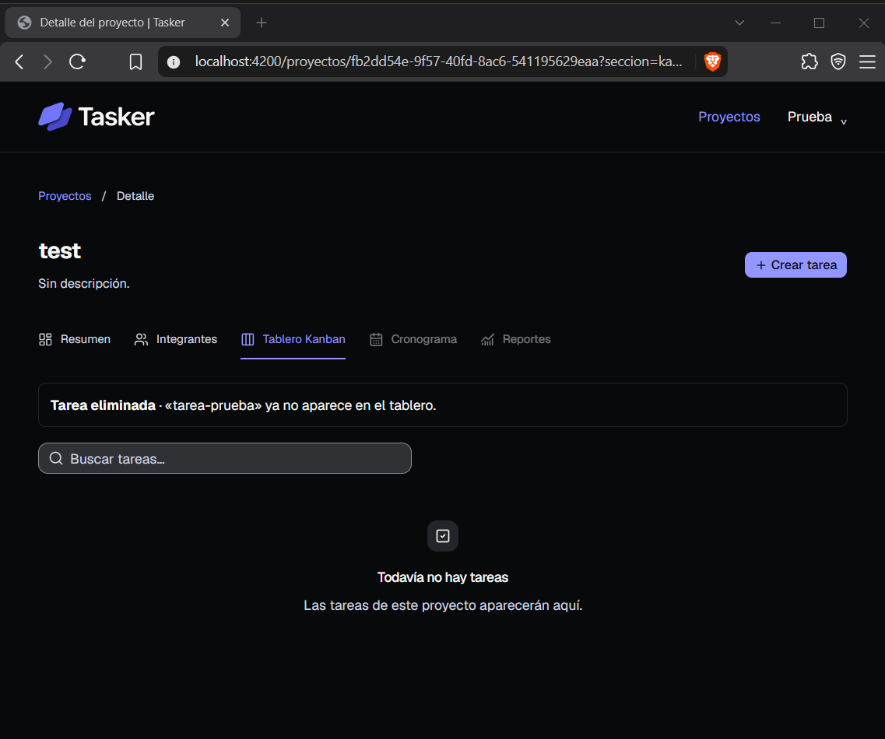
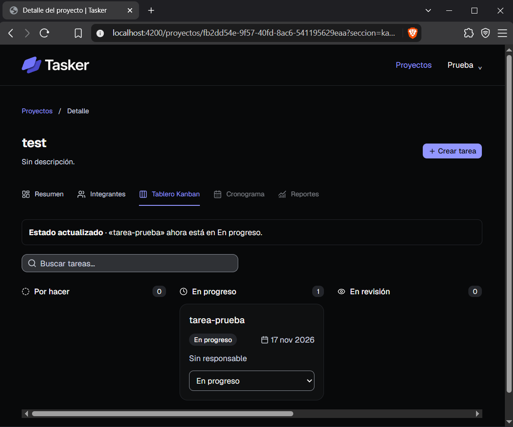

# HU-42 — Registro de ejecución de pruebas de gestión de tareas

**Proyecto:** Tasker  
**Historia de Jira:** SCRUM-58 — HU-42  
**Enlace:** https://api-proyecto-disc01.atlassian.net/browse/SCRUM-58  
**Responsable:** QA  
**Tipo de ejecución:** Pruebas funcionales manuales  
**Versión del registro:** 1.0  
**Fecha de elaboración:** 16 de noviembre de 2026  
**Fecha y hora de ejecución:** Pendientes de registrar  
**Ejecutor:** Responsable de QA  
**Rama y commit del frontend probado:** Pendientes de registrar  
**Aplicación:** Angular, `http://localhost:4200`  
**Backend:** Supabase alojado, compartido por el equipo  
**Sistema operativo:** Windows  
**Navegador y versión:** Pendientes de registrar  
**Plan de referencia:** HU-39 — Plan Maestro de Pruebas  
**Datos de referencia:** HU-53 — DS-01, DS-02, DS-03, DS-04 y DS-05  
**Estado:** Ejecución parcial, con un defecto funcional confirmado por QA y dependencias pendientes de implementación.

## 1. Objetivo

Documentar los resultados de las pruebas de gestión de tareas de Tasker conforme a los criterios de aceptación de HU-42, incluyendo creación, consulta, edición, eliminación, asignación de responsables, cambios de estado, validación de fechas y restricciones de autorización.

Los resultados se registran mediante las fichas de ejecución del Anexo A del Plan Maestro de Pruebas HU-39 y se relacionan con los datasets definidos en HU-53.

## 2. Alcance y condiciones de ejecución

Las pruebas se realizaron manualmente desde la aplicación Angular conectada al Supabase compartido del equipo.

QA reportó que las funcionalidades de creación, consulta y eliminación de tareas funcionan correctamente. También confirmó el funcionamiento de los cambios de estado y las validaciones de fechas.

Durante la prueba de edición se identificó un problema funcional: al seleccionar el botón Editar, la aplicación no responde a la acción esperada. Por este motivo, la edición se registra como fallida.

Las funcionalidades de asignación de responsables, permisos del propietario y restricción de cambio de estado exclusivamente al usuario asignado no están implementadas. Por tanto, las comprobaciones que dependen de ellas permanecen bloqueadas.

No se ha confirmado que los scripts de restauración de HU-53 hayan sido ejecutados antes de esta campaña. Las referencias a datasets indican los conjuntos de datos previstos, sin afirmar que todos los registros de QA fueron cargados.

Las funcionalidades que presentan resultados satisfactorios se registran según lo informado por QA. Los pasos adicionales de persistencia, permisos y límites que no hayan sido comprobados permanecen pendientes de verificación.

## 3. Matriz de trazabilidad

| Criterio de aceptación | Caso de prueba | Dataset | Estado |
|---|---|---|---|
| Creación de tareas | CP-TAR-01 | DS-02, DS-04 | Aprobado |
| Formulario con datos inválidos o vacíos | CP-TAR-02 | DS-05 | Pendiente de completar; se verificaron fechas |
| Edición de tareas | CP-TAR-03 | DS-04 | Fallido |
| Eliminación de tareas | CP-TAR-04 | DS-04 | Aprobado |
| Cambio de responsable | CP-TAR-05 | DS-03, DS-04 | Bloqueado |
| Cambio de estado por usuario asignado | CP-TAR-06 | DS-04 | Bloqueado para validación completa de HU-31 |
| Rechazo de cambio de estado por no asignado | CP-TAR-07 | DS-03, DS-04 | Bloqueado |
| Consulta funcional de tareas | EXT-TAR-01 | DS-02, DS-04 | Aprobado |
| Validación de fechas | EXT-TAR-02 | DS-05 | Aprobado |
| Cambio funcional de estado, sin comprobar autorización | EXT-TAR-03 | DS-04 | Aprobado según QA |
| Registro de defectos | DEF-HU42-01 | — | Defecto documentado |

Los casos CP-TAR-01 a CP-TAR-07 corresponden al inventario original de HU-39.

Los identificadores EXT-TAR-01, EXT-TAR-02 y EXT-TAR-03 se utilizan para documentar comprobaciones funcionales adicionales de manera independiente. No se incorporan al total original de 45 casos de HU-39 sin la aprobación correspondiente.

La prueba de cambio funcional de estado no sustituye CP-TAR-06 ni CP-TAR-07, ya que ambos incluyen restricciones específicas de autorización.

## 4. Fichas de ejecución

### CP-TAR-01 — Creación de tareas

**Historia:** SCRUM-58 / HU-42  
**Módulo:** Gestión de tareas  
**Prioridad:** Alta  
**Estado:** Aprobado según QA

| Campo | Registro |
|---|---|
| ID del caso / historia | CP-TAR-01 / HU-42 |
| Módulo y prioridad | Gestión de tareas / Alta |
| Ejecutado por / fecha y hora | QA / pendientes de registrar |
| Build / commit / navegador | Pendientes de registrar |
| Entorno / versión del dataset | Angular y Supabase compartido / DS-02, DS-04 |
| Precondiciones | Usuario autenticado, proyecto disponible y formulario de creación de tareas habilitado |
| Resultado esperado | La tarea se crea con datos válidos, aparece en el proyecto y conserva sus campos después de recargar |
| Resultado observado | QA confirmó que la creación de tareas funciona correctamente |
| Estado | Aprobado según QA |
| Evidencia / Jira de defecto | EV-HU42-01 / sin defecto reportado |
| Observaciones / próxima acción | Incorporar captura y confirmar persistencia tras recargar, si no se verificó |

**Pasos de prueba:**

1. Iniciar sesión con una cuenta de prueba.
2. Acceder a un proyecto disponible.
3. Abrir el formulario de creación de tareas.
4. Introducir los datos requeridos con valores válidos.
5. Guardar la tarea.
6. Verificar que la aplicación muestre el registro creado.
7. Recargar la página y comprobar que la tarea conserva sus datos.

**Resultado:** Aprobado según la ejecución reportada por QA.

La aprobación reportada corresponde al funcionamiento de creación. No se declara comprobada la persistencia después de recargar si esa acción no se realizó durante la prueba.

### CP-TAR-02 — Validación de datos inválidos o campos vacíos

**Historia:** SCRUM-58 / HU-42  
**Módulo:** Formularios de tareas  
**Prioridad:** Alta  
**Estado:** Pendiente de completar

| Campo | Registro |
|---|---|
| ID del caso / historia | CP-TAR-02 / HU-42 |
| Módulo y prioridad | Validaciones de formularios / Alta |
| Ejecutado por / fecha y hora | QA / ejecución parcial reportada |
| Build / commit / navegador | Pendientes de registrar |
| Entorno / versión del dataset | Angular y Supabase compartido / DS-05 |
| Precondiciones | Formulario de creación de tareas disponible |
| Resultado esperado | El formulario rechaza campos inválidos o vacíos conforme a las reglas aprobadas y no crea registros incorrectos |
| Resultado observado | QA confirmó que las validaciones de fechas funcionan. No se informó el resultado de todas las demás validaciones de campos |
| Estado | Pendiente de completar |
| Evidencia / Jira de defecto | EV-HU42-06 para fechas / sin defecto confirmado |
| Observaciones / próxima acción | Verificar campos obligatorios y otros valores inválidos definidos en Jira |

**Pasos de prueba:**

1. Abrir el formulario de tareas.
2. Intentar guardar una tarea omitiendo un campo obligatorio.
3. Comprobar la validación correspondiente.
4. Introducir otros valores inválidos conforme a las reglas aprobadas.
5. Intentar guardar nuevamente.
6. Comprobar que el formulario no acepte indebidamente esos datos.
7. Registrar los mensajes obtenidos.

**Resultado:** Pendiente de completar.

La validación de fechas se registra por separado como aprobada en EXT-TAR-02. Esa comprobación no permite afirmar que todas las demás reglas del formulario hayan sido probadas.

### CP-TAR-03 — Edición de tareas

**Historia:** SCRUM-58 / HU-42  
**Módulo:** Gestión de tareas  
**Prioridad:** Alta  
**Estado:** Fallido

| Campo | Registro |
|---|---|
| ID del caso / historia | CP-TAR-03 / HU-42 |
| Módulo y prioridad | Gestión de tareas / Alta |
| Ejecutado por / fecha y hora | QA / pendientes de registrar |
| Build / commit / navegador | Pendientes de registrar |
| Entorno / versión del dataset | Angular y Supabase compartido / DS-04 |
| Precondiciones | Usuario autenticado y tarea existente con botón Editar visible |
| Resultado esperado | Al seleccionar Editar, la aplicación permite modificar los campos autorizados y guardar cambios persistentes |
| Resultado observado | Al seleccionar el botón Editar, la interfaz no responde con la acción esperada y no se puede completar la edición |
| Estado | Fallido |
| Evidencia / Jira de defecto | EV-HU42-03 / DEF-HU42-01 |
| Observaciones / próxima acción | Reportar el defecto a desarrollo y repetir la prueba después de corregirlo |

**Pasos de prueba:**

1. Iniciar sesión en Tasker.
2. Acceder al proyecto que contiene una tarea existente.
3. Ubicar la tarea que se desea modificar.
4. Seleccionar el botón Editar.
5. Observar si se abre el formulario o se habilita la edición.
6. Registrar que no ocurre la respuesta esperada.

**Resultado:** Fallido.

La edición no pudo completarse porque el botón Editar no responde. No se ha identificado todavía la causa técnica del problema.

No se atribuye el error a Angular, Supabase, permisos, eventos del navegador ni políticas RLS sin un análisis posterior.

### CP-TAR-04 — Eliminación de tareas

**Historia:** SCRUM-58 / HU-42  
**Módulo:** Gestión de tareas  
**Prioridad:** Media  
**Estado:** Aprobado según QA

| Campo | Registro |
|---|---|
| ID del caso / historia | CP-TAR-04 / HU-42 |
| Módulo y prioridad | Gestión de tareas / Media |
| Ejecutado por / fecha y hora | QA / pendientes de registrar |
| Build / commit / navegador | Pendientes de registrar |
| Entorno / versión del dataset | Angular y Supabase compartido / DS-04 |
| Precondiciones | Tarea descartable de prueba y funcionalidad de eliminación disponible |
| Resultado esperado | La tarea se elimina mediante el flujo autorizado y la aplicación refleja el resultado |
| Resultado observado | QA confirmó que la eliminación de tareas funciona correctamente |
| Estado | Aprobado según QA |
| Evidencia / Jira de defecto | EV-HU42-04 / sin defecto reportado |
| Observaciones / próxima acción | Documentar la confirmación y desaparición del registro, cuando corresponda |

**Pasos de prueba:**

1. Acceder a un proyecto con una tarea descartable.
2. Seleccionar la tarea.
3. Utilizar la opción Eliminar.
4. Confirmar la operación si el sistema presenta una confirmación.
5. Comprobar que el resultado se refleja en el listado.
6. Recargar la vista para verificar el estado persistido.

**Resultado:** Aprobado según QA.

La prueba debe realizarse únicamente sobre registros de prueba autorizados, debido a que Supabase es compartido.

### CP-TAR-05 — Asignación o cambio de responsable

**Historia:** SCRUM-58 / HU-42  
**Módulo:** Responsables de tareas  
**Prioridad:** Alta  
**Estado:** Bloqueado

| Campo | Registro |
|---|---|
| ID del caso / historia | CP-TAR-05 / HU-42 |
| Módulo y prioridad | Asignaciones / Alta |
| Ejecutado por / fecha y hora | QA / no ejecutado |
| Build / commit / navegador | Pendientes de registrar |
| Entorno / versión del dataset | Angular y Supabase compartido / DS-03, DS-04 |
| Precondiciones | Proyecto con integrantes y controles de asignación habilitados |
| Resultado esperado | Un usuario autorizado puede asignar o cambiar el responsable de una tarea y la relación se conserva |
| Resultado observado | QA informó que la asignación de responsables todavía no está implementada |
| Estado | Bloqueado |
| Evidencia / Jira de defecto | No disponible / dependencia de implementación |
| Observaciones / próxima acción | Ejecutar al estar disponible la asignación de responsables |

**Pasos pendientes:**

1. Preparar un proyecto con integrantes.
2. Acceder a una tarea del proyecto.
3. Abrir la opción para asignar responsable.
4. Seleccionar un integrante permitido.
5. Guardar la asignación.
6. Verificar el responsable asociado.
7. Cambiarlo por otro integrante permitido.
8. Comprobar la persistencia del cambio.

**Resultado:** No ejecutado por falta de implementación.

### CP-TAR-06 — Cambio de estado realizado por el usuario asignado

**Historia:** SCRUM-58 / HU-42, relacionada con HU-31  
**Módulo:** Estados y autorización  
**Prioridad:** Crítica  
**Estado:** Bloqueado para validación completa

| Campo | Registro |
|---|---|
| ID del caso / historia | CP-TAR-06 / HU-42 |
| Módulo y prioridad | Estados y permisos / Crítica |
| Ejecutado por / fecha y hora | QA / verificación funcional parcial reportada |
| Build / commit / navegador | Pendientes de registrar |
| Entorno / versión del dataset | Angular y Supabase compartido / DS-04 |
| Precondiciones | Tarea con responsable asignado y sesión autenticada del responsable |
| Resultado esperado | El usuario asignado puede cambiar el estado de su tarea entre los estados permitidos y los cambios persisten |
| Resultado observado | QA confirmó que el cambio funcional de estado opera correctamente, pero no existe la asignación de responsables necesaria para verificar que el usuario sea el asignado |
| Estado | Bloqueado para validación completa |
| Evidencia / Jira de defecto | EV-HU42-05, relativa al cambio funcional / dependencia HU-31 |
| Observaciones / próxima acción | Verificar la identidad asignada, permisos y persistencia una vez implementadas las asignaciones |

**Pasos pendientes para completar el caso:**

1. Preparar una tarea asignada a un integrante específico.
2. Iniciar sesión con la cuenta de ese integrante.
3. Cambiar la tarea de Por hacer a En progreso.
4. Cambiarla posteriormente a Completada.
5. Recargar la aplicación.
6. Verificar que los cambios se conservaron y que fueron realizados por el usuario autorizado.

**Resultado:** El cambio funcional de estado fue reportado como satisfactorio, pero no puede declararse aprobado el caso completo de HU-31.

### CP-TAR-07 — Restricción de cambio de estado para usuario no asignado

**Historia:** SCRUM-58 / HU-42, relacionada con HU-31  
**Módulo:** Seguridad y permisos  
**Prioridad:** Crítica  
**Estado:** Bloqueado

| Campo | Registro |
|---|---|
| ID del caso / historia | CP-TAR-07 / HU-42 |
| Módulo y prioridad | Seguridad / Crítica |
| Ejecutado por / fecha y hora | QA / no ejecutado |
| Build / commit / navegador | Pendientes de registrar |
| Entorno / versión del dataset | Angular y Supabase compartido / DS-03, DS-04 |
| Precondiciones | Tarea asignada a un usuario y otro integrante del proyecto sin asignación a esa tarea |
| Resultado esperado | El usuario no asignado no puede modificar el estado desde la interfaz ni mediante solicitudes no privilegiadas a Supabase |
| Resultado observado | La asignación de responsables y sus restricciones de autorización no están implementadas |
| Estado | Bloqueado |
| Evidencia / Jira de defecto | No disponible |
| Observaciones / próxima acción | Coordinar validación de interfaz y RLS con backend |

**Pasos pendientes:**

1. Preparar una tarea asignada a un integrante.
2. Iniciar sesión con otro integrante del mismo proyecto que no esté asignado a esa tarea.
3. Intentar modificar su estado.
4. Comprobar que la operación sea rechazada.
5. Verificar que el estado permanezca sin cambios.
6. Comprobar la restricción mediante una solicitud autenticada no privilegiada a Supabase.

**Resultado:** No ejecutado.

No se confirma ningún defecto de autorización porque las condiciones necesarias para realizar la prueba aún no están implementadas.

### EXT-TAR-01 — Consulta funcional de tareas

**Historia:** SCRUM-58 / HU-42  
**Módulo:** Consulta de tareas  
**Prioridad:** Alta, caso complementario  
**Estado:** Aprobado según QA

| Campo | Registro |
|---|---|
| ID del caso / historia | EXT-TAR-01 / HU-42 |
| Módulo y prioridad | Consulta de tareas / Alta |
| Ejecutado por / fecha y hora | QA / pendientes de registrar |
| Build / commit / navegador | Pendientes de registrar |
| Entorno / versión del dataset | Angular y Supabase compartido / DS-02, DS-04 |
| Precondiciones | Proyecto con tareas existentes |
| Resultado esperado | El usuario puede consultar las tareas visibles en el proyecto y sus datos correspondientes |
| Resultado observado | QA informó que la consulta de tareas funciona correctamente |
| Estado | Aprobado según QA |
| Evidencia / Jira de defecto | EV-HU42-02 / sin defecto reportado |
| Observaciones / próxima acción | Registrar los campos y datos comprobados en la consulta |

**Pasos de prueba:**

1. Iniciar sesión.
2. Acceder a un proyecto con tareas.
3. Abrir el listado o la vista de tareas.
4. Comprobar que las tareas del proyecto se visualizan.
5. Consultar los datos disponibles de una tarea.
6. Verificar que la información corresponda a la tarea seleccionada.

**Resultado:** Aprobado según QA.

La consulta funcional no demuestra por sí sola que los usuarios sin autorización tengan restringido el acceso a las tareas.

### EXT-TAR-02 — Validación de fechas de tareas

**Historia:** SCRUM-58 / HU-42  
**Módulo:** Formularios y fechas  
**Prioridad:** Alta, caso complementario  
**Estado:** Aprobado según QA

| Campo | Registro |
|---|---|
| ID del caso / historia | EXT-TAR-02 / HU-42 |
| Módulo y prioridad | Validación de fechas / Alta |
| Ejecutado por / fecha y hora | QA / pendientes de registrar |
| Build / commit / navegador | Pendientes de registrar |
| Entorno / versión del dataset | Angular y Supabase compartido / DS-05 |
| Precondiciones | Formulario de tareas con campos de fecha disponible |
| Resultado esperado | La aplicación valida las fechas conforme a las restricciones aprobadas y rechaza las combinaciones inválidas |
| Resultado observado | QA confirmó que las validaciones de fechas funcionan correctamente |
| Estado | Aprobado según QA |
| Evidencia / Jira de defecto | EV-HU42-06 / sin defecto reportado |
| Observaciones / próxima acción | Registrar las fechas concretas utilizadas y el mensaje de validación, si lo hubo |

**Pasos de prueba:**

1. Abrir el formulario de creación de tareas.
2. Introducir las fechas requeridas.
3. Intentar guardar una combinación que incumpla las restricciones configuradas.
4. Comprobar que la validación se active.
5. Corregir las fechas.
6. Verificar que la aplicación permita continuar con valores válidos.

**Resultado:** Aprobado según QA.

No se declara que se hayan probado fechas iguales, valores extremos u otras combinaciones específicas sin evidencia de su ejecución.

### EXT-TAR-03 — Cambio funcional de estado de tareas

**Historia:** SCRUM-58 / HU-42  
**Módulo:** Estados de tareas  
**Prioridad:** Alta, caso complementario  
**Estado:** Aprobado según QA

| Campo | Registro |
|---|---|
| ID del caso / historia | EXT-TAR-03 / HU-42 |
| Módulo y prioridad | Estados de tareas / Alta |
| Ejecutado por / fecha y hora | QA / pendientes de registrar |
| Build / commit / navegador | Pendientes de registrar |
| Entorno / versión del dataset | Angular y Supabase compartido / DS-04 |
| Precondiciones | Tarea disponible y control de cambio de estado habilitado |
| Resultado esperado | La tarea cambia al estado seleccionado, dentro de las transiciones permitidas por la aplicación |
| Resultado observado | QA confirmó que la funcionalidad de cambio de estado opera correctamente |
| Estado | Aprobado según QA |
| Evidencia / Jira de defecto | EV-HU42-05 / sin defecto funcional reportado |
| Observaciones / próxima acción | Registrar las transiciones realizadas y comprobar su persistencia tras recargar |

**Pasos de prueba:**

1. Abrir un proyecto con tareas.
2. Seleccionar una tarea.
3. Utilizar el control de cambio de estado.
4. Seleccionar otro estado disponible.
5. Comprobar que la aplicación refleja el cambio.
6. Recargar la vista y verificar el estado persistido.

**Resultado:** Aprobado según QA.

Esta prueba confirma el funcionamiento general reportado del cambio de estado. No verifica que solo el responsable asignado pueda ejecutar la operación.

## 5. Registro de defectos

### DEF-HU42-01 — El botón Editar de tareas no responde

**Identificador provisional de QA:** DEF-HU42-01  
**Historia afectada:** SCRUM-58 / HU-42  
**Caso afectado:** CP-TAR-03  
**Tipo:** Defecto funcional  
**Severidad propuesta:** Alta  
**Estado:** Abierto, pendiente de corrección y reejecución  
**Responsable técnico:** Por asignar en Jira  
**Identificador definitivo de Jira:** Pendiente de creación o vinculación

**Descripción:**

Durante las pruebas de gestión de tareas se identificó que el botón Editar no responde a la interacción del usuario. Esto impide acceder al flujo de edición y modificar los datos de una tarea existente desde la aplicación.

**Precondiciones:**

- Usuario autenticado en Tasker.
- Proyecto con al menos una tarea.
- Botón Editar disponible en la interfaz.

**Pasos para reproducir:**

1. Iniciar sesión en Tasker.
2. Acceder a un proyecto con tareas.
3. Localizar una tarea existente.
4. Seleccionar el botón Editar.
5. Observar la respuesta de la aplicación.

**Resultado esperado:**

La aplicación debe abrir el formulario de edición o habilitar el mecanismo correspondiente para modificar los campos permitidos de la tarea.

**Resultado obtenido:**

El botón Editar no produce la respuesta funcional esperada. La edición no puede completarse desde el flujo probado.

**Impacto:**

El usuario no puede modificar los datos de una tarea mediante el botón de edición, lo que impide satisfacer el criterio de edición de HU-42.

**Evidencia:** EV-HU42-03.

**Acción recomendada:**

El equipo de desarrollo debe revisar la interacción del botón Editar y su integración con el formulario o mecanismo de edición, identificar la causa y corregirla.

Después de integrar la corrección, QA deberá repetir CP-TAR-03 y comprobar la persistencia de los cambios.

La causa técnica permanece sin determinar. No se atribuye el fallo a un componente específico sin evidencia adicional.

## 6. Resumen de ejecución

### 6.1. Casos originales del Plan Maestro de Pruebas HU-39

| Estado | Cantidad | Casos |
|---|---:|---|
| Aprobados | 2 | CP-TAR-01, CP-TAR-04 |
| Fallidos | 1 | CP-TAR-03 |
| Bloqueados | 3 | CP-TAR-05, CP-TAR-06, CP-TAR-07 |
| Pendientes de completar | 1 | CP-TAR-02 |
| Total | 7 | — |

El cambio de estado funciona según QA, pero CP-TAR-06 todavía requiere comprobar que el usuario que lo ejecuta sea el asignado de la tarea. Por eso no se declara aprobado el caso completo.

### 6.2. Comprobaciones complementarias

| Caso | Funcionalidad | Estado |
|---|---|---|
| EXT-TAR-01 | Consulta de tareas | Aprobado |
| EXT-TAR-02 | Validación de fechas | Aprobado |
| EXT-TAR-03 | Cambio funcional de estado | Aprobado |

Los casos complementarios se documentan de manera independiente sin modificar el inventario de 45 casos originales de HU-39.

### 6.3. Resultado por criterio de aceptación

| Criterio | Resultado |
|---|---|
| Creación | Aprobada |
| Consulta | Aprobada |
| Edición | Fallida |
| Eliminación | Aprobada |
| Asignación de responsables | Bloqueada |
| Cambio funcional de estado | Aprobado |
| Fechas | Aprobadas |
| Permisos del propietario | Bloqueados |
| Cambio de estado exclusivo del asignado | Bloqueado |
| Registro de resultados | Documentado |

**Resultado general:** ejecución parcial con un defecto funcional identificado, restricciones de autorización no implementadas y verificaciones de formulario pendientes de completar.

No corresponde declarar HU-42 completamente aprobada.

## 7. Inventario de evidencias

Las siguientes referencias identifican las evidencias que deberán obtenerse y adjuntarse. No se afirma que ya hayan sido capturadas o subidas a GitHub.

| ID | Evidencia requerida | Caso |
|---|---|---|
| EV-HU42-01 | Creación correcta de una tarea | CP-TAR-01 |
| EV-HU42-02 | Consulta de tareas | EXT-TAR-01 |
| EV-HU42-03 | Botón Editar sin respuesta; preferiblemente video corto o registro de interacción | CP-TAR-03 |
| EV-HU42-04 | Eliminación de una tarea de prueba | CP-TAR-04 |
| EV-HU42-05 | Cambio funcional de estado | EXT-TAR-03 |
| EV-HU42-06 | Validación de fechas | EXT-TAR-02 |

### 7.1. Ubicación propuesta

`docs/qa/evidencias/hu-42/`

Archivos propuestos:

```text
EV-HU42-01-creacion-tarea.png
EV-HU42-02-consulta-tareas.png
EV-HU42-03-error-edicion-tarea.png
EV-HU42-04-eliminacion-tarea.png
EV-HU42-05-cambio-estado.png
EV-HU42-06-validacion-fechas.png
```

Si el archivo de evidencia está en otro formato, debe conservarse su extensión real y actualizarse su referencia.

Para el caso EV-HU42-03, una captura puede mostrar el botón Editar, pero no demostrar por sí sola que no responde. Es recomendable acompañarla de un video breve o una descripción reproducible de los pasos y del resultado.

### 7.2. Incorporación de evidencias

Una vez adjuntados los archivos con los nombres anteriores, se podrán añadir estas referencias al documento:

**EV-HU42-01 — Creación de tarea**


**EV-HU42-02 — Consulta de tareas**


**EV-HU42-03 — Fallo del botón Editar**


**EV-HU42-04 — Eliminación de tarea**



**EV-HU42-05 — Cambio funcional de estado**



**EV-HU42-06 — Validación de fechas**


Las capturas deben revisarse para evitar publicar contraseñas, tokens, claves de API o información sensible.

## 8. Dependencias, riesgos y acciones pendientes

1. Registrar DEF-HU42-01 como incidencia en Jira y vincularla a SCRUM-58.
2. Corregir el funcionamiento del botón Editar y reejecutar CP-TAR-03.
3. Implementar la asignación y el cambio de responsable de tareas.
4. Verificar que el propietario tenga únicamente los permisos definidos en las historias vigentes.
5. Comprobar que solo el asignado pueda modificar el estado, según HU-31.
6. Ejecutar la prueba negativa de cambio de estado por integrante no asignado.
7. Verificar las restricciones de autorización tanto desde Angular como mediante políticas RLS en Supabase.
8. Completar las validaciones restantes del formulario previstas en CP-TAR-02.
9. Documentar las fechas y transiciones concretas utilizadas en las pruebas.
10. Incorporar las evidencias visuales disponibles.
11. Registrar la rama, commit, navegador y fecha de ejecución.
12. Reejecutar los casos afectados cuando desarrollo integre las correcciones pendientes.

## 9. Estado de HU-42

**Estado:** ejecución parcial, con defecto funcional abierto y casos bloqueados por implementación pendiente.

Las pruebas reportadas de creación, consulta y eliminación de tareas presentan resultados favorables. También funcionan, según QA, las validaciones de fechas y el mecanismo general de cambio de estado.

La edición no cumple el comportamiento esperado porque el botón Editar no responde. Este defecto se documenta como DEF-HU42-01, pendiente de registro o vinculación con Jira y posterior corrección.

Las comprobaciones relacionadas con responsables, permisos del propietario y cambio de estado exclusivo del asignado permanecen bloqueadas.

No se reportaron otros defectos confirmados. Los escenarios que todavía no pueden ejecutarse no se consideran pruebas fallidas.

El documento puede incorporarse al repositorio y presentarse a revisión como registro parcial de HU-42. La historia no debe declararse completamente aprobada hasta resolver el defecto y verificar los criterios pendientes, o contar con una decisión formal del equipo sobre su alcance.
