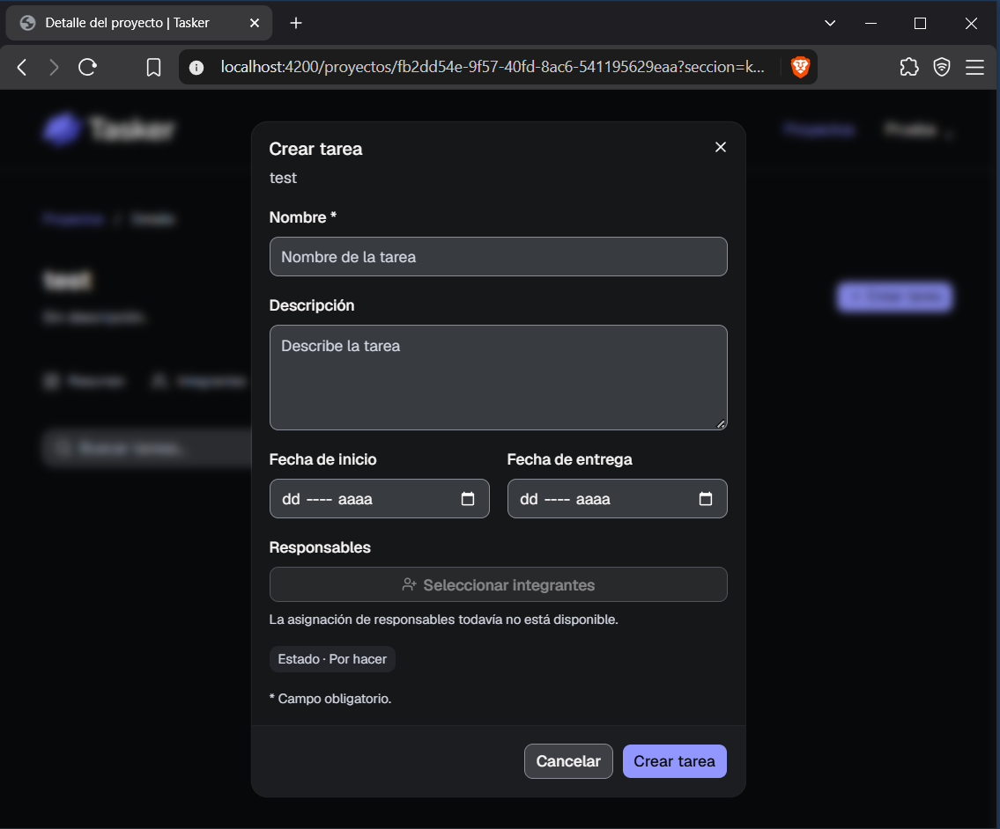
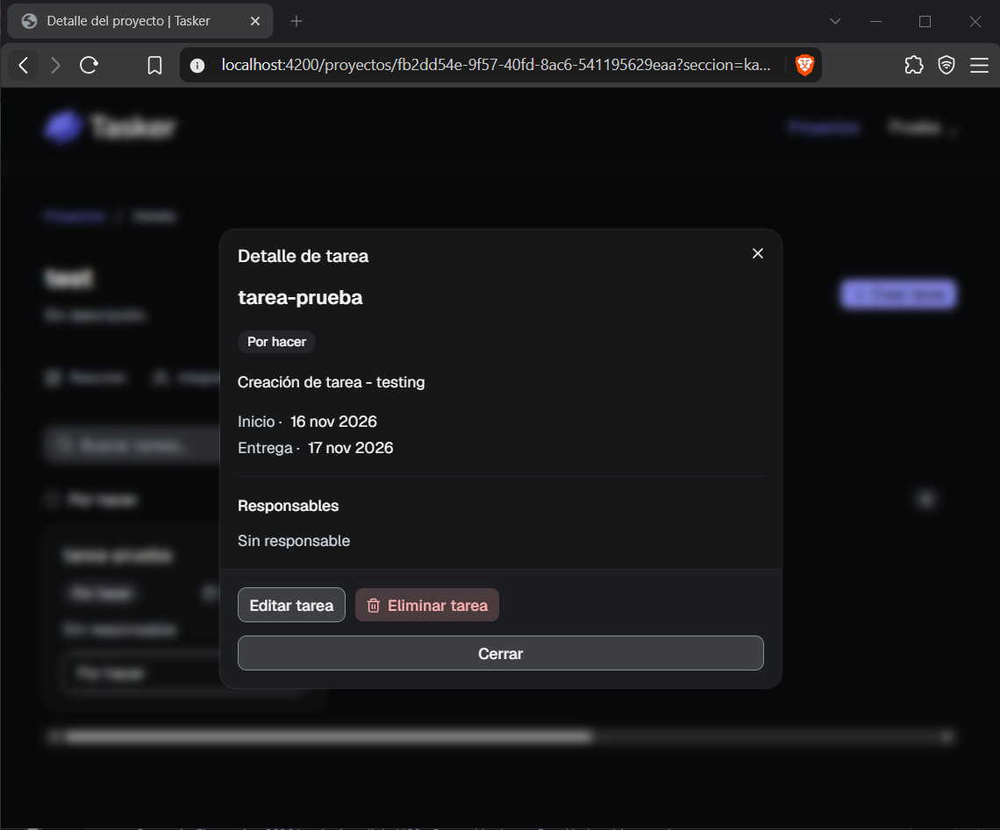
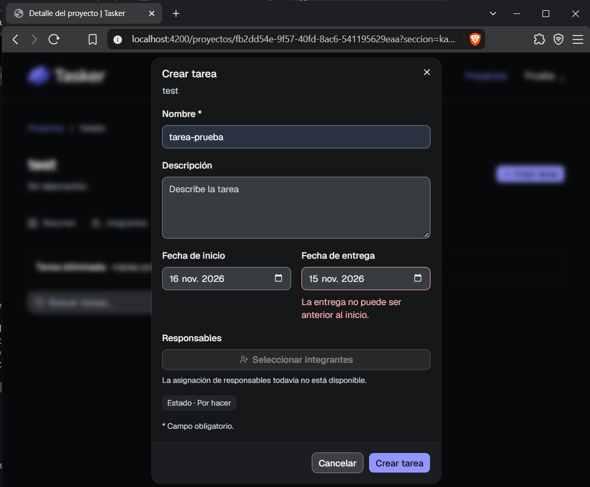

# HU-42 — Registro de ejecución de pruebas de gestión de tareas

**Proyecto:** Tasker  
**Historia de Jira:** SCRUM-58 — HU-42  
**Enlace:** https://api-proyecto-disc01.atlassian.net/browse/SCRUM-58  
**Responsable:** QA  
**Tipo de ejecución:** Pruebas funcionales manuales  
**Versión del registro:** 1.1  
**Fecha de actualización:** 16 de noviembre de 2026  
**Fecha y hora de ejecución:** Pendientes de completar con los registros reales  
**Ejecutor:** Responsable de QA  
**Rama y commit del frontend probado:** Pendientes de registrar  
**Aplicación:** Angular, `http://localhost:4200`  
**Backend:** Supabase alojado, compartido por el equipo  
**Sistema operativo:** Windows  
**Navegador y versión:** Pendientes de registrar  
**Plan de referencia:** HU-39 — Plan Maestro de Pruebas  
**Datos de referencia:** HU-53 — DS-01, DS-02, DS-03, DS-04 y DS-05  
**Estado:** Ejecución parcial actualizada, sin casos originales fallidos actualmente

## 1. Objetivo

Documentar los resultados de las pruebas funcionales de gestión de tareas correspondientes a HU-42, conforme a los criterios de aceptación registrados en Jira.

Las pruebas comprenden creación, consulta, edición y eliminación de tareas, asignación de responsables, cambios de estado, validación de fechas y restricciones de autorización.

Se verifica especialmente el comportamiento establecido en HU-31: solamente el usuario asignado a una tarea debe poder modificar su estado.

Los resultados se registran mediante los casos del Plan Maestro de Pruebas HU-39 y los datasets relacionados de HU-53.

## 2. Alcance y condiciones de ejecución

Las pruebas se realizaron manualmente desde Angular, utilizando la conexión existente con el Supabase compartido del equipo.

Durante la primera ejecución, QA confirmó el funcionamiento de la creación, consulta y eliminación de tareas, los cambios generales de estado y las validaciones de fechas.

En esa ejecución se identificó que el botón Editar no respondía, lo que impedía completar la modificación de una tarea existente.

En la actualización de esta historia, QA confirmó que el botón Editar ya funciona. Por tanto, CP-TAR-03 se actualiza de fallido a aprobado, conservando el historial del defecto detectado.

También se confirmó el funcionamiento de las siguientes restricciones:

- El usuario asignado puede cambiar el estado de su tarea.
- Un usuario no asignado no puede modificar el estado de esa tarea.

En consecuencia, CP-TAR-06 y CP-TAR-07 pasan a estado aprobado según la ejecución reportada por QA.

La asignación o el cambio de responsable desde la aplicación no se ha confirmado como implementada, por lo que CP-TAR-05 permanece bloqueado de acuerdo con la última información disponible.

Las validaciones de fechas se encuentran aprobadas. Sin embargo, no se dispone de resultados completos para todas las validaciones generales del formulario, por lo que CP-TAR-02 continúa pendiente de completar.

No se ha confirmado la restauración de los datasets de HU-53 durante esta campaña. Sus identificadores se utilizan como referencias de los datos requeridos para reproducir los escenarios.

Las pruebas de autorización reportadas corresponden al comportamiento funcional observado. No se afirma que hayan sido ejecutadas pruebas independientes sobre políticas RLS mediante solicitudes directas autenticadas a Supabase.

## 3. Matriz de trazabilidad

| Criterio de aceptación | Caso | Dataset | Estado |
|---|---|---|---|
| Creación de tareas | CP-TAR-01 | DS-02, DS-04 | Aprobado |
| Validaciones generales del formulario | CP-TAR-02 | DS-05 | Pendiente de completar |
| Edición de tareas | CP-TAR-03 | DS-04 | Aprobado |
| Eliminación de tareas | CP-TAR-04 | DS-04 | Aprobado |
| Asignación o cambio de responsable | CP-TAR-05 | DS-03, DS-04 | Bloqueado |
| Cambio de estado por usuario asignado | CP-TAR-06 | DS-04 | Aprobado |
| Rechazo de cambio de estado por usuario no asignado | CP-TAR-07 | DS-03, DS-04 | Aprobado |
| Consulta funcional de tareas | EXT-TAR-01 | DS-02, DS-04 | Aprobado |
| Validación de fechas | EXT-TAR-02 | DS-05 | Aprobado |
| Cambio funcional de estado | EXT-TAR-03 | DS-04 | Aprobado |
| Registro y seguimiento del defecto de edición | DEF-HU42-01 | — | Corregido funcionalmente según QA |

Los casos CP-TAR-01 a CP-TAR-07 pertenecen al inventario original de HU-39.

EXT-TAR-01, EXT-TAR-02 y EXT-TAR-03 son casos complementarios utilizados para documentar las comprobaciones funcionales de manera independiente. No modifican el total original de 45 casos de HU-39.

## 4. Fichas de ejecución

### CP-TAR-01 — Creación de tareas

**Historia:** SCRUM-58 / HU-42  
**Módulo:** Gestión de tareas  
**Prioridad:** Alta  
**Estado:** Aprobado

| Campo | Registro |
|---|---|
| Identificador | CP-TAR-01 |
| Precondiciones | Usuario autenticado, proyecto disponible y formulario de creación habilitado |
| Dataset | DS-02, DS-04 |
| Resultado esperado | La tarea se crea con datos válidos y aparece en el proyecto correspondiente |
| Resultado observado | QA confirmó que la creación de tareas funciona correctamente |
| Estado | Aprobado según QA |
| Evidencia | EV-HU42-01 |
| Defectos | No se reportaron |

**Procedimiento de prueba:**

1. Iniciar sesión con una cuenta de prueba.
2. Acceder a un proyecto disponible.
3. Abrir el formulario de creación de tareas.
4. Completar los campos requeridos con datos válidos.
5. Guardar la tarea.
6. Comprobar que la tarea aparezca en la aplicación.
7. Verificar los datos registrados.

**Resultado:** Aprobado según la ejecución reportada.

La persistencia tras recargar deberá identificarse expresamente en la evidencia cuando se haya verificado.

### CP-TAR-02 — Validaciones generales del formulario

**Historia:** SCRUM-58 / HU-42  
**Módulo:** Formularios de tareas  
**Prioridad:** Alta  
**Estado:** Pendiente de completar

| Campo | Registro |
|---|---|
| Identificador | CP-TAR-02 |
| Precondiciones | Formulario de tareas disponible |
| Dataset | DS-05 |
| Resultado esperado | El formulario rechaza datos inválidos o campos obligatorios vacíos conforme a sus reglas |
| Resultado observado | Se confirmó el funcionamiento de las validaciones de fechas, pero no se informaron resultados completos sobre las demás reglas del formulario |
| Estado | Pendiente de completar |
| Evidencia | EV-HU42-06, correspondiente únicamente a fechas |
| Defectos | Ninguno confirmado para este caso |

**Procedimiento pendiente:**

1. Abrir el formulario de creación de tareas.
2. Intentar guardar una tarea con campos obligatorios vacíos.
3. Verificar las respuestas de validación.
4. Introducir otros valores inválidos previstos en los requisitos.
5. Comprobar que el sistema no acepte indebidamente los datos.
6. Registrar los mensajes y resultados obtenidos.

**Resultado:** Pendiente de completar.

Las validaciones de fechas se mantienen aprobadas en EXT-TAR-02.

### CP-TAR-03 — Edición de tareas

**Historia:** SCRUM-58 / HU-42  
**Módulo:** Gestión de tareas  
**Prioridad:** Alta  
**Estado:** Aprobado

| Campo | Registro |
|---|---|
| Identificador | CP-TAR-03 |
| Precondiciones | Usuario autenticado y tarea existente con opción Editar disponible |
| Dataset | DS-04 |
| Resultado esperado | El botón Editar permite modificar los campos autorizados y guardar los cambios |
| Resultado observado | QA confirmó que la edición de tareas ya funciona correctamente |
| Estado inicial | Fallido: el botón Editar no respondía |
| Estado actual | Aprobado según QA |
| Evidencia anterior | EV-HU42-03 — fallo del botón Editar |
| Evidencia de reejecución | EV-HU42-07 — edición corregida, pendiente de incorporar |
| Defecto asociado | DEF-HU42-01 |

**Procedimiento de reejecución:**

1. Iniciar sesión en Tasker.
2. Acceder a un proyecto que contenga una tarea existente.
3. Seleccionar el botón Editar.
4. Comprobar que se habilite el formulario o mecanismo de edición.
5. Modificar un campo permitido de la tarea.
6. Guardar los cambios.
7. Comprobar que la aplicación muestre la información modificada.
8. Verificar la persistencia después de recargar, si esta comprobación forma parte de la ejecución.

**Resultado:** Aprobado según la nueva ejecución reportada por QA.

**Actualización de versión 1.1:** El defecto que impedía editar tareas ya no se reproduce en el flujo probado. Se mantiene su registro histórico para conservar la trazabilidad entre el fallo inicial y la corrección.

El cierre administrativo de la incidencia en Jira deberá verificarse por separado.

### CP-TAR-04 — Eliminación de tareas

**Historia:** SCRUM-58 / HU-42  
**Módulo:** Gestión de tareas  
**Prioridad:** Media  
**Estado:** Aprobado

| Campo | Registro |
|---|---|
| Identificador | CP-TAR-04 |
| Precondiciones | Tarea descartable de prueba y operación de eliminación disponible |
| Dataset | DS-04 |
| Resultado esperado | La tarea se elimina correctamente y el resultado se refleja en la aplicación |
| Resultado observado | QA confirmó que la eliminación de tareas funciona correctamente |
| Estado | Aprobado según QA |
| Evidencia | EV-HU42-04 |
| Defectos | No se reportaron |

**Procedimiento de prueba:**

1. Acceder al proyecto que contiene una tarea descartable.
2. Seleccionar la tarea.
3. Utilizar la opción Eliminar.
4. Confirmar la operación si corresponde.
5. Comprobar que la tarea deje de aparecer como disponible.
6. Verificar el resultado después de actualizar la vista, si se realizó esa comprobación.

**Resultado:** Aprobado según QA.

La operación debe realizarse exclusivamente sobre datos de prueba autorizados.

### CP-TAR-05 — Asignación o cambio de responsable

**Historia:** SCRUM-58 / HU-42  
**Módulo:** Responsables de tareas  
**Prioridad:** Alta  
**Estado:** Bloqueado

| Campo | Registro |
|---|---|
| Identificador | CP-TAR-05 |
| Precondiciones | Proyecto con integrantes y funcionalidad de asignación de responsables disponible |
| Dataset | DS-03, DS-04 |
| Resultado esperado | Un usuario autorizado puede asignar o cambiar el responsable de una tarea y guardar la relación |
| Resultado observado | No se ha confirmado que la asignación o el cambio de responsables desde la aplicación esté implementado |
| Estado | Bloqueado, según la última información disponible |
| Evidencia | No disponible |
| Defectos | No se registra defecto funcional de ejecución |

**Procedimiento pendiente:**

1. Iniciar sesión con una cuenta autorizada.
2. Abrir un proyecto con integrantes.
3. Seleccionar una tarea.
4. Abrir la funcionalidad de asignación.
5. Seleccionar a un integrante permitido.
6. Guardar la asignación.
7. Comprobar que el responsable aparezca asociado a la tarea.
8. Cambiarlo por otro integrante autorizado.
9. Verificar que la modificación se conserve.

**Resultado:** No ejecutado en este registro por falta de confirmación de la funcionalidad.

La aprobación de las restricciones de cambio de estado no demuestra que se haya probado la operación de asignar o cambiar responsables desde la interfaz.

### CP-TAR-06 — Cambio de estado por usuario asignado

**Historia:** SCRUM-58 / HU-42, relacionada con HU-31  
**Módulo:** Estados y autorización  
**Prioridad:** Crítica  
**Estado:** Aprobado según QA

| Campo | Registro |
|---|---|
| Identificador | CP-TAR-06 |
| Precondiciones | Tarea con responsable asignado y sesión autenticada del usuario correspondiente |
| Dataset | DS-04 |
| Resultado esperado | El usuario asignado puede modificar el estado de su tarea mediante las transiciones permitidas |
| Resultado observado | QA confirmó que el cambio de estado realizado por el usuario asignado funciona correctamente |
| Estado inicial | Bloqueado para validación completa |
| Estado actual | Aprobado según QA |
| Evidencia | EV-HU42-08 — cambio de estado por usuario asignado |
| Defectos | No se reportaron |

**Procedimiento de prueba:**

1. Preparar una tarea con un responsable identificado.
2. Iniciar sesión con la cuenta del usuario asignado.
3. Acceder a la tarea.
4. Modificar su estado mediante el control disponible.
5. Comprobar que la aplicación acepte el cambio.
6. Verificar que se muestre el nuevo estado.
7. Comprobar su persistencia después de actualizar la vista, si esta acción fue ejecutada.

**Resultado:** Aprobado según la ejecución reportada por QA.

**Actualización de versión 1.1:** Se confirmó que el usuario asignado puede cambiar el estado de la tarea.

Esta aprobación corresponde al comportamiento probado desde la aplicación. La persistencia y los permisos de la API deberán documentarse por separado si no fueron verificados.

### CP-TAR-07 — Rechazo de cambio de estado por usuario no asignado

**Historia:** SCRUM-58 / HU-42, relacionada con HU-31  
**Módulo:** Seguridad y permisos  
**Prioridad:** Crítica  
**Estado:** Aprobado según QA

| Campo | Registro |
|---|---|
| Identificador | CP-TAR-07 |
| Precondiciones | Tarea asignada a un usuario y otro usuario autenticado que no sea el responsable |
| Dataset | DS-03, DS-04 |
| Resultado esperado | El usuario no asignado no puede modificar el estado de la tarea |
| Resultado observado | QA confirmó que la aplicación rechaza el cambio de estado cuando lo intenta un usuario no asignado |
| Estado inicial | Bloqueado |
| Estado actual | Aprobado según QA |
| Evidencia | EV-HU42-09 — rechazo de cambio de estado por usuario no asignado |
| Defectos | No se reportaron |

**Procedimiento de prueba:**

1. Preparar una tarea con un responsable asignado.
2. Iniciar sesión con otra cuenta que no sea la asignada.
3. Acceder a la tarea.
4. Intentar modificar su estado.
5. Comprobar que la aplicación impida o rechace la operación.
6. Verificar que el estado de la tarea permanezca sin cambios.

**Resultado:** Aprobado según QA.

**Actualización de versión 1.1:** Se confirmó el rechazo de cambios de estado realizados por usuarios no asignados.

La aprobación funcional no acredita automáticamente una prueba independiente de las restricciones RLS de Supabase. Si dicha comprobación se realizó, deberán incorporarse el procedimiento y su evidencia.

### EXT-TAR-01 — Consulta funcional de tareas

**Historia:** SCRUM-58 / HU-42  
**Módulo:** Consulta de tareas  
**Prioridad:** Alta, caso complementario  
**Estado:** Aprobado

| Campo | Registro |
|---|---|
| Identificador | EXT-TAR-01 |
| Precondiciones | Proyecto con tareas existentes |
| Dataset | DS-02, DS-04 |
| Resultado esperado | El usuario puede consultar las tareas visibles y su información |
| Resultado observado | QA confirmó que la consulta de tareas funciona correctamente |
| Estado | Aprobado |
| Evidencia | EV-HU42-02 |
| Defectos | No se reportaron |

**Procedimiento de prueba:**

1. Iniciar sesión.
2. Acceder a un proyecto.
3. Abrir el listado o la vista de tareas.
4. Seleccionar una tarea cuando corresponda.
5. Comprobar los datos mostrados.

**Resultado:** Aprobado según QA.

### EXT-TAR-02 — Validación de fechas de tareas

**Historia:** SCRUM-58 / HU-42  
**Módulo:** Formularios y fechas  
**Prioridad:** Alta, caso complementario  
**Estado:** Aprobado

| Campo | Registro |
|---|---|
| Identificador | EXT-TAR-02 |
| Precondiciones | Formulario de tareas con campos de fecha disponibles |
| Dataset | DS-05 |
| Resultado esperado | El formulario valida las fechas conforme a las restricciones configuradas |
| Resultado observado | QA confirmó que las validaciones de fechas funcionan correctamente |
| Estado | Aprobado |
| Evidencia | EV-HU42-06 |
| Defectos | No se reportaron |

**Procedimiento de prueba:**

1. Abrir el formulario de tareas.
2. Introducir fechas que incumplan una restricción definida.
3. Intentar continuar con el registro.
4. Comprobar que la validación se active.
5. Corregir las fechas.
6. Verificar que los valores válidos sean aceptados.

**Resultado:** Aprobado según QA.

La evidencia deberá identificar las fechas utilizadas y el mensaje mostrado, cuando corresponda.

### EXT-TAR-03 — Cambio funcional de estado de tareas

**Historia:** SCRUM-58 / HU-42  
**Módulo:** Estados de tareas  
**Prioridad:** Alta, caso complementario  
**Estado:** Aprobado

| Campo | Registro |
|---|---|
| Identificador | EXT-TAR-03 |
| Precondiciones | Tarea disponible con un control de cambio de estado habilitado |
| Dataset | DS-04 |
| Resultado esperado | La aplicación actualiza el estado de la tarea mediante una transición permitida |
| Resultado observado | QA confirmó que el cambio funcional de estado opera correctamente |
| Estado | Aprobado |
| Evidencia | EV-HU42-05 |
| Defectos | No se reportaron |

**Procedimiento de prueba:**

1. Acceder a un proyecto con tareas.
2. Seleccionar una tarea.
3. Utilizar el control para cambiar su estado.
4. Seleccionar otro estado permitido.
5. Comprobar que la aplicación refleje el cambio.

**Resultado:** Aprobado según QA.

Este caso complementa las pruebas de autorización CP-TAR-06 y CP-TAR-07, pero no las sustituye.

## 5. Seguimiento de defectos

### DEF-HU42-01 — El botón Editar de tareas no respondía

**Identificador provisional:** DEF-HU42-01  
**Historia relacionada:** SCRUM-58 — HU-42  
**Caso afectado:** CP-TAR-03  
**Tipo:** Defecto funcional  
**Severidad propuesta:** Alta  
**Estado inicial:** Abierto, pendiente de corrección  
**Estado funcional actual:** Corregido y revalidado según QA  
**Estado administrativo en Jira:** Pendiente de verificar  
**Identificador definitivo de Jira:** Pendiente de registrar

**Descripción inicial:**

Durante las pruebas de edición de tareas, se identificó que el botón Editar no respondía a la interacción del usuario, lo que impedía completar la modificación de una tarea existente.

**Resultado esperado inicial:**

Al seleccionar Editar, el sistema debía abrir o habilitar el mecanismo para modificar los datos de la tarea.

**Resultado obtenido inicialmente:**

La aplicación no producía la respuesta esperada y no permitía completar la edición.

**Resultado de la nueva ejecución:**

QA confirmó que la edición de tareas ya funciona correctamente.

**Evidencias:**

- EV-HU42-03: fallo inicial del botón Editar.
- EV-HU42-07: resultado de la edición después de la corrección.

**Estado de seguimiento:**

El defecto ya no se reproduce según la nueva ejecución reportada. Debe mantenerse la relación entre la incidencia original y la reejecución de CP-TAR-03.

No se declara cerrado el ticket en Jira sin verificar su estado real.

## 6. Resumen de ejecución

### 6.1. Casos originales de HU-39

| Estado | Cantidad | Identificadores |
|---|---:|---|
| Aprobados | 5 | CP-TAR-01, CP-TAR-03, CP-TAR-04, CP-TAR-06, CP-TAR-07 |
| Fallidos actualmente | 0 | Ninguno |
| Bloqueados | 1 | CP-TAR-05 |
| Pendientes de completar | 1 | CP-TAR-02 |
| Total | 7 | — |

**Resultado:** Cinco casos originales aprobados según QA, uno bloqueado y uno pendiente de completar.

El defecto inicial de CP-TAR-03 se conserva en el historial, aunque el caso actualmente está aprobado según la nueva ejecución.

### 6.2. Casos complementarios

| Caso | Funcionalidad | Estado |
|---|---|---|
| EXT-TAR-01 | Consulta de tareas | Aprobado |
| EXT-TAR-02 | Validación de fechas | Aprobado |
| EXT-TAR-03 | Cambio funcional de estado | Aprobado |

Los tres casos complementarios permanecen aprobados.

### 6.3. Resultado por criterio de aceptación

| Criterio | Estado |
|---|---|
| Creación de tareas | Aprobado |
| Consulta de tareas | Aprobado |
| Edición de tareas | Aprobado |
| Eliminación de tareas | Aprobado |
| Asignación o cambio de responsables | Bloqueado |
| Cambios funcionales de estado | Aprobado |
| Validación de fechas | Aprobado |
| Cambio de estado por usuario asignado | Aprobado |
| Rechazo de cambio de estado por usuario no asignado | Aprobado |
| Validaciones generales del formulario | Pendiente de completar |
| Registro de resultados | Documentado |

No se reportaron defectos funcionales activos en los casos originales aprobados.

La historia conserva un caso bloqueado y una verificación pendiente.

## 7. Inventario de evidencias

| ID | Descripción | Caso | Situación |
|---|---|---|---|
| EV-HU42-01 | Creación de tarea | CP-TAR-01 | Verificar incorporación |
| EV-HU42-02 | Consulta de tareas | EXT-TAR-01 | Verificar incorporación |
| EV-HU42-03 | Fallo inicial del botón Editar | CP-TAR-03 | Conservar si existe |
| EV-HU42-04 | Eliminación de tarea | CP-TAR-04 | Verificar incorporación |
| EV-HU42-05 | Cambio funcional de estado | EXT-TAR-03 | Verificar incorporación |
| EV-HU42-06 | Validación de fechas | EXT-TAR-02 | Verificar incorporación |
| EV-HU42-07 | Edición corregida de tarea | CP-TAR-03 | Pendiente de adjuntar |
| EV-HU42-08 | Cambio de estado por usuario asignado | CP-TAR-06 | Pendiente de adjuntar |
| EV-HU42-09 | Rechazo de cambio por usuario no asignado | CP-TAR-07 | Pendiente de adjuntar |

### 7.1. Ubicación en el repositorio

`docs/qa/evidencias/hu-42/`

Archivos propuestos:

```text
EV-HU42-01-creacion-tarea.png
EV-HU42-02-consulta-tareas.png
EV-HU42-03-error-edicion-tarea.png
EV-HU42-04-eliminacion-tarea.png
EV-HU42-05-cambio-estado.png
EV-HU42-06-validacion-fechas.png
EV-HU42-07-edicion-corregida.png
EV-HU42-08-estado-usuario-asignado.png
EV-HU42-09-rechazo-usuario-no-asignado.png
```

Conservar las extensiones reales de los archivos. No se deben crear evidencias ficticias para completar el inventario.

### 7.2. Evidencias visuales

Cuando las capturas estén incorporadas, sus enlaces podrán registrarse así:

**EV-HU42-01 — Creación de tarea**



**EV-HU42-02 — Consulta de tareas**


**EV-HU42-03 — Fallo inicial de edición**



**EV-HU42-04 — Eliminación de tarea**


**EV-HU42-05 — Cambio funcional de estado**


**EV-HU42-06 — Validación de fechas**



Para las pruebas de autorización, las evidencias deben permitir distinguir el rol o condición del usuario que intenta modificar el estado, sin exponer credenciales.

La comprobación del rechazo debería incluir también el estado final de la tarea, para respaldar que no fue modificada indebidamente.

## 8. Dependencias y acciones pendientes

1. Confirmar la implementación de la asignación y cambio de responsables desde la aplicación.
2. Ejecutar CP-TAR-05 cuando se encuentre disponible la funcionalidad.
3. Completar CP-TAR-02 con las validaciones generales de campos obligatorios y datos inválidos.
4. Incorporar evidencias de la edición corregida y de los cambios de estado permitidos y rechazados.
5. Verificar y documentar la persistencia de las modificaciones realizadas.
6. Registrar el identificador definitivo y el estado de la incidencia de edición en Jira.
7. Registrar fechas, navegador, rama y commit del frontend probado.
8. Comprobar las restricciones RLS mediante solicitudes autenticadas no privilegiadas, si estas pruebas forman parte de la validación requerida y todavía no se han ejecutado.
9. Actualizar los resultados y la trazabilidad si se incorporan nuevas funcionalidades de asignación.

## 9. Estado de HU-42

**Estado:** ejecución parcial actualizada, con cinco casos originales aprobados, uno bloqueado y uno pendiente de completar.

Las funcionalidades de creación, consulta, edición y eliminación de tareas fueron reportadas como satisfactorias. También funcionan las validaciones de fechas y el cambio general de estado.

La edición de tareas fue corregida y aprobada en la nueva ejecución reportada por QA. El defecto inicial permanece documentado para conservar el historial de pruebas.

Se aprobaron las comprobaciones de cambio de estado por usuario asignado y rechazo del cambio realizado por un usuario no asignado, conforme al comportamiento solicitado por HU-31.

La asignación o cambio de responsables desde la aplicación todavía no está confirmada como implementada. Las validaciones generales del formulario permanecen pendientes de completar.

La documentación puede actualizarse y presentarse a revisión. HU-42 no debe declararse completamente aprobada mientras existan criterios pendientes o bloqueados.
